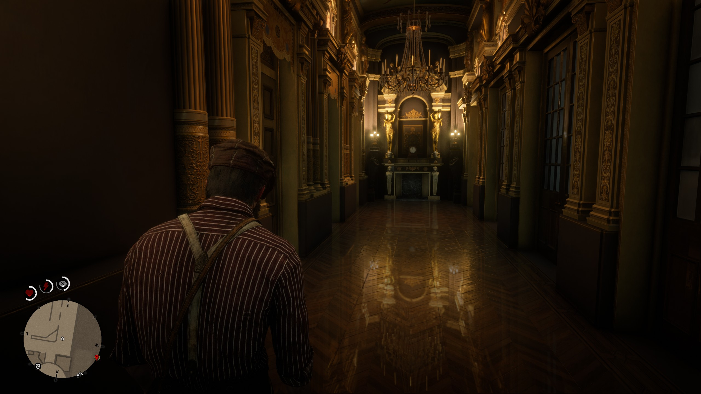
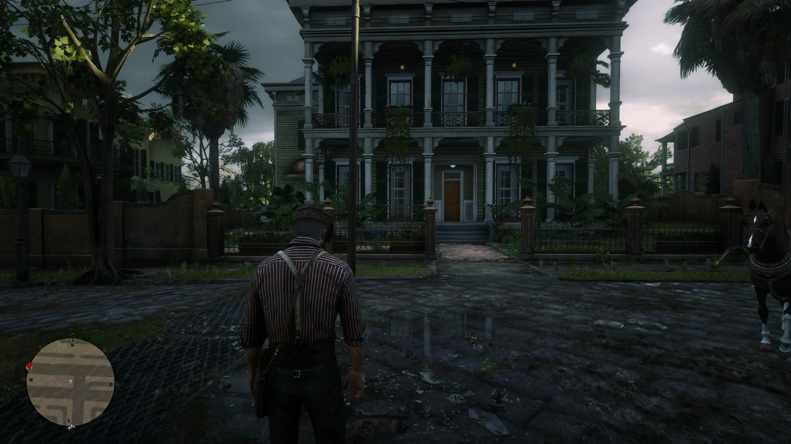
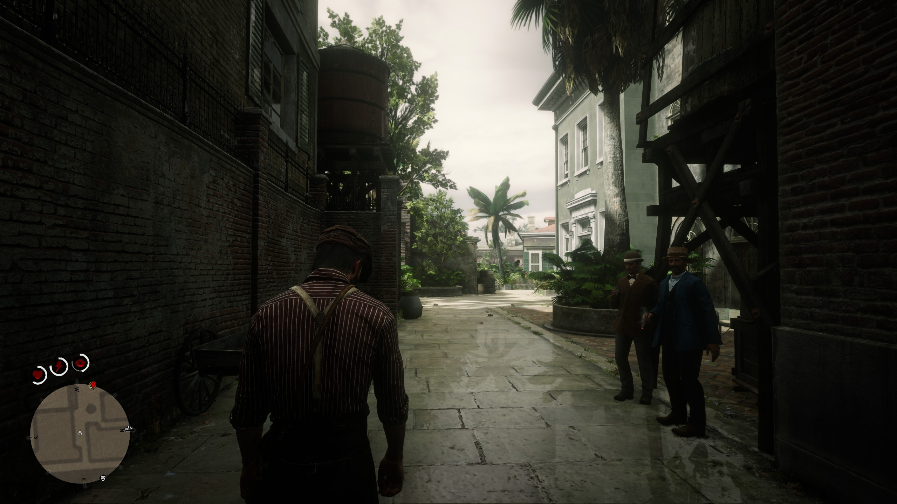

# URTI — Universal Ray Tracing Injector

URTI adds real-time **ray-traced reflections** to DirectX 12 games that do not have them, without modifying their
files or shaders. It is a [ReShade](https://reshade.me) add-on. It watches the game's rendering, rebuilds the scene on
its side and casts real rays into it with DXR 1.1 inline ray queries.



Red Dead Redemption 2 with URTI. The polished parquet mirrors the chandelier, the gilded statues and the candles. The
game has no ray tracing of its own.

| | |
|---|---|
|  |  |
| A puddle on the cobblestones reflects the facade and its columns. | Wet flagstones in an alley pick up the passers-by and the buildings. |

## What it does

- **Ray-traced reflections** on water, puddles, glass and polished surfaces. They are stable over time and drawn on
  every presented frame, including frame-generated ones.
- **Optional glossy floors**: polished floors close to the camera can get a reflection blurred by their roughness
  (`gloss_min=`). Off by default: sharp mirrors look better than a blurred sheen on every pavement.
- **Off-screen content.** Reflected points that are hidden or off screen take their colour from a world-space radiance
  cache (a spatial hash after NVIDIA's SHaRC) filled from what the screen has shown. Rays that leave the scene read a
  learned sky map.
- **One checkbox.** The ReShade menu shows a single "URTI" box; everything else is tuned automatically.
- **Optional ambient occlusion**, kept in the code and off by default.

## How it works, in short

1. **Geometry capture.** Every draw of the game is replayed through stream output, so URTI gets the triangles exactly
   as the game's vertex shaders transformed them (animation, instancing and terrain tessellation included).
2. **Measurements.** Depth law, field of view, sun direction, sub-pixel jitter and camera motion are measured from the
   game's own frames; nothing is hard-coded per game except a few material slots.
3. **RT scene.** A per-frame acceleration structure for what is near and moving, plus an object cache for everything
   else.
4. **Reflection rays.** Only on surfaces that the game's G-buffer marks as smooth, flat and extended, under a time
   budget enforced every frame.
5. **Stabilisation and composition.** The reflection is denoised, reprojected with the motion of the reflected point,
   and composed on every displayed frame in HDR, leaving the UI untouched.

The full walkthrough, with diagrams and the reasoning behind each step: **[docs/HOW_IT_WORKS.md](docs/HOW_IT_WORKS.md)**.
The log of every experiment and measurement: [docs/JOURNAL.md](docs/JOURNAL.md) (in French).

## Tested games

| Game | Effects | Settings (`urti.ini`) |
|---|---|---|
| Red Dead Redemption 2 | reflections on puddles, wet streets, windows, polished floors | `ui_photo=0`, `ui_zone=0.012,0.69,0.16,0.97`, `jitter=0`, `sun_measure=0` |
| Horizon Forbidden West (Complete Edition) | water reflections | `camera_cb=512`, `material_slot=4`, `reflect_channel=0`, `reflect_invert=1`, `smooth_min=0.9`, `person_mask=0` |

In Horizon Forbidden West, the in-game Reflections option must stay on: URTI reads the game's camera from that pass.

**Single player only.** URTI injects itself into the game's rendering: never use it online.

## Installation

You need a DXR 1.1 capable GPU and [ReShade](https://reshade.me) 6.8 **with add-on support**.

1. Install ReShade into the game folder (or use `tools/reshade/install.py`, reversible with `--remove`).
2. Copy `urti.addon64` next to the game executable, and the `reshade/` effects into ReShade's effect folder.
3. Create `urti.ini` in the same place as the game executable, with `live=1`, `reflect=1` and the game's settings from
   the table above.

| Key | Action |
|---|---|
| F7 | turn URTI on or off (same as the menu checkbox) |
| F4 | before / after, full screen |
| F5 | split screen, without and with URTI |
| F8 | measurement burst: 30 frames saved without and with URTI |

## Building

Requirements: Windows 10 or 11, Visual Studio 2022 (C++), CMake 3.20 or newer, and
[dxc](https://github.com/microsoft/DirectXShaderCompiler).

```sh
cmake -S urti -B urti/build -DURTI_DXC="C:/path/to/dxc.exe"
cmake --build urti/build --config Release
```

The add-on is written to `urti/build/Release/urti.addon64`.

## Useful settings

| Key | Role | Default |
|---|---|---|
| `refl_ms` | time budget for reflections (ms, 0: no budget) | 3.5 |
| `smooth_min` | smoothness above which a surface is a mirror | 0.5 |
| `gloss_min`, `gloss` | glossy floors: lowest smoothness (0: off) and strength | 0, 1 |
| `radcache` | world radiance cache for hidden and off-screen reflected points | 1 |
| `water_gain` | weight of the reflection on water, relative to Fresnel | 1.5 |
| `lag` | lay each effect layer on the frame it belongs to (frame generation) | 1 |
| `fg_shift` | shift of the effects on generated frames (0: frozen) | 0.5 |
| `hudless` | use the UI-free image provided by the game | 1 |
| `tess` | capture tessellated draws (terrain) | 0 |
| `fov_auto` | measure the game's field of view and correct the projection | 1 |
| `ao` | optional ambient occlusion strength (also needs the hidden `UrtiOcclusion` box) | 1 |

## Measuring

Every change is judged in the game, against the same frame without URTI:

- **In-game tests.** `tools/reshade/` holds automated tests: launch, walk, turn, bursts, and real-pace films kept in
  GPU memory.
- **Analysis.** `tools/analyse/` holds the analysis tools:

| Tool | Measures |
|---|---|
| `rafale_bruit.py` | flicker added by URTI on top of what the game itself changes |
| `decalage.py` | alignment at a tenth of a pixel (phase correlation): does the effect follow the image, is it offset, how stable is it |
| `trainee.py` | trails while the camera turns |

Perceptual comparisons use NVIDIA's [FLIP](https://github.com/NVlabs/flip).

## Repository layout

| Folder | Content |
|---|---|
| `urti/` | the add-on (C++, HLSL) and its test bench |
| `reshade/` | the ReShade effects that carry the menu and the depth access |
| `tools/` | installation, in-game automated tests, analysis |
| `docs/` | how it works, journal, roadmap, results |
| `src/`, `krc_sdk/` | KRC, the radiance cache studied first |
| `third_party/` | SHaRC and patches for Quake II RTX, RTGL1 and RTXGI |
| `results/` | measurements and captures |

## KRC — Knowledge Radiance Cache

The repository also contains the research prototype behind the project: a spatial radiance cache where each cell knows
its own uncertainty, so that rays go where the doubt is. Protocol in [docs/HYPOTHESE.md](docs/HYPOTHESE.md),
measurements in [docs/RESULTATS.md](docs/RESULTATS.md).

```sh
cargo run --release -- all      # references and every method
cargo run --release -- sponza 480
```

## Limits

- **Per-game profile.** Each game needs a small settings profile (material slots, and the camera's constant buffer
  when one is found).
- **Unsupported draws.** Mesh-shader draws are not captured.
- **Colours of hidden points.** A reflected point never seen on screen has an approximate colour.
- **UI protection.** Without a UI-free image from the game, only a fixed screen area is protected.

## License

URTI and KRC code is under the [MIT](LICENSE) license. Third-party code keeps the license of its original project:
`third_party/`, `urti/third_party/` (ReShade, Dear ImGui), `reshade/ReShade*.fxh`. NVIDIA's NRD, optionally compiled
in, is not part of the repository.

This project is not affiliated with Rockstar Games, Guerrilla Games, Sony, NVIDIA or ReShade.
