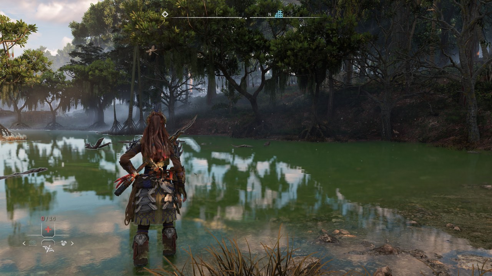
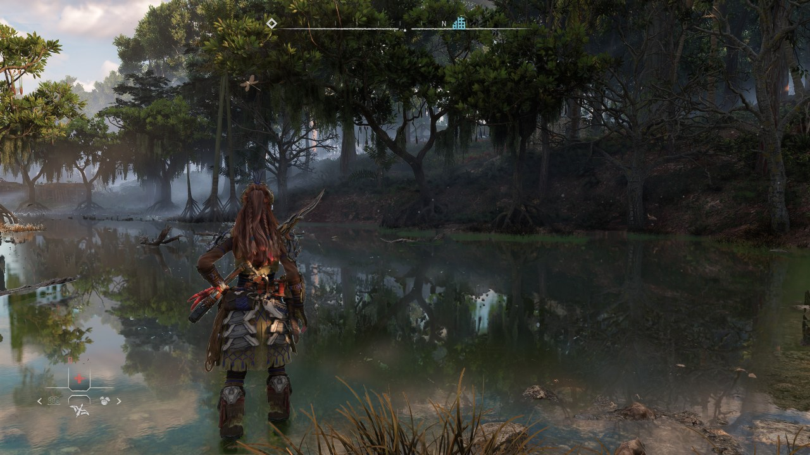
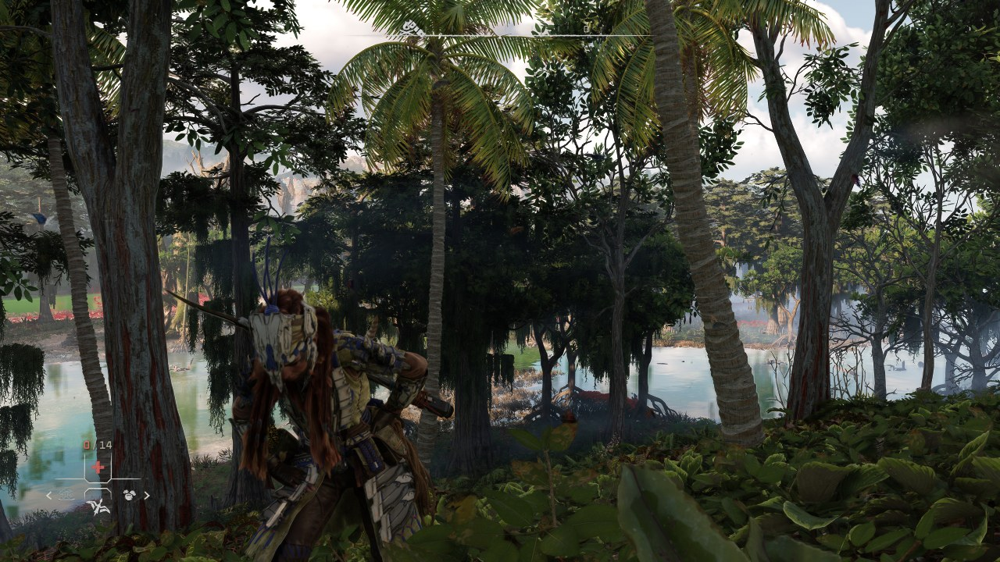
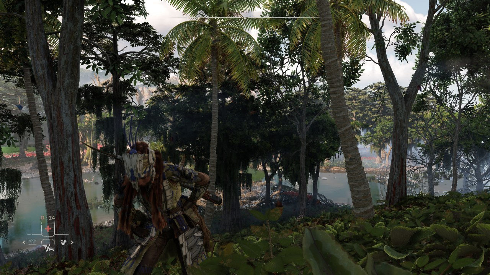
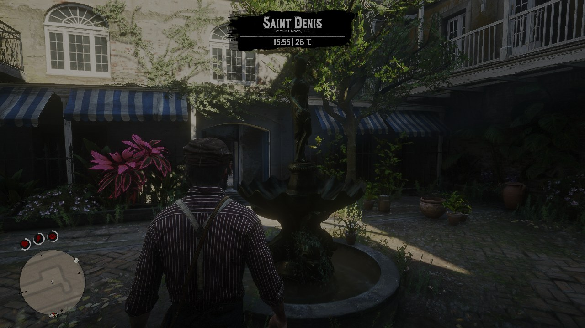
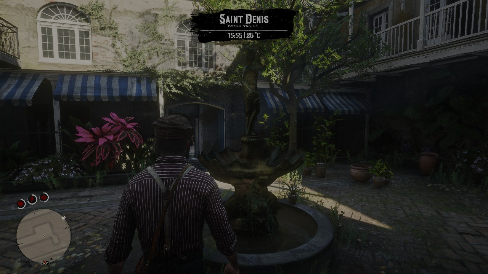

# URTI — Universal Ray Tracing Injector

URTI adds real-time ray tracing to DirectX 12 games that do not have it, without modifying their files or shaders.
It is a [ReShade](https://reshade.me) add-on: it watches the game's rendering, rebuilds the scene on its side and
casts real rays into it (DXR 1.1).

| Without URTI | With URTI |
|---|---|
|  |  |
|  |  |
|  |  |

Horizon Forbidden West, water: the game's own low-resolution reflection (green, in blocks) is replaced by a ray-traced
mirror of the forest. Forest: ray-traced ambient occlusion and light bounce. Red Dead Redemption 2: light bounced by the
sunlit ground reaches the shaded fountain and walls.

## What it adds

- **Ray-traced ambient occlusion**, in the real geometry of the scene, off-screen included.
- **Diffuse light bounce**, from colours already seen on screen.
- **Reflections** on water and wet surfaces, stabilised over time.

## How it works

1. **Geometry capture.** Every draw of the game is replayed through stream output: URTI gets the triangles as the
   vertex shaders transformed them (animation and instancing included), with nothing to decode.
2. **RT scene.** One acceleration structure per frame for what is near and moving, plus an object cache for
   everything else, placed with the game's camera.
3. **Rays.** Compute passes with inline ray queries: occlusion, bounce, reflections. Each pass has a time budget
   enforced every frame.
4. **Composition.** The denoised and stabilised result is applied to the game image. The UI stays untouched when
   the game provides an image without its UI.

The detailed log of experiments and measurements is in [docs/JOURNAL.md](docs/JOURNAL.md) (in French).

## Tested games

| Game | Effects | Settings (`urti.ini`) |
|---|---|---|
| Red Dead Redemption 2 | occlusion, bounce, reflections on wet surfaces | `ui_photo=0`, `ui_zone=0.012,0.69,0.16,0.97`, `jitter=0`, `shadow_rays=2` |
| Horizon Forbidden West (Complete Edition) | occlusion, bounce, water reflections | `camera_cb=512`, `material_slot=4`, `reflect_channel=0`, `reflect_invert=1`, `smooth_min=0.9`, `ao_rough=1`, `person_mask=0` |

In Horizon Forbidden West, the in-game Reflections option must stay on: URTI reads the game's camera from that
pass.

**Story mode only.** URTI injects itself into the game's rendering: never use it online.

## Installation

You need a DXR 1.1 capable GPU and [ReShade](https://reshade.me) 6.8 **with add-on support**.

1. Install ReShade into the game folder (or use `tools/reshade/install.py`, reversible with `--remove`).
2. Copy `urti.addon64` next to the game executable.
3. Create `urti.ini` in the same place, with `live=1`, `ao=1`, `reflect=1` and the game's settings (table above).

| Key | Action |
|---|---|
| F7 | turn URTI on or off |
| F5 | split screen, without and with URTI |
| F8 | measurement burst: 30 frames saved without and with URTI |

## Building

Requirements: Windows 10 or 11, Visual Studio 2022 (C++), CMake 3.20 or newer, and
[dxc](https://github.com/microsoft/DirectXShaderCompiler).

```sh
cmake -S urti -B urti/build -DURTI_DXC="C:/path/to/dxc.exe"
cmake --build urti/build --config Release
```

The add-on is written to `urti/build/Release/urti.addon64`.

## Useful settings

| Key | Role | Default |
|---|---|---|
| `ao_ms` | target time for occlusion and its denoising (ms, 0: no budget) | 4 |
| `refl_ms` | target time for reflections (ms, 0: no budget) | 3.5 |
| `ao_radius` | occlusion range (m) | per game |
| `water_gain` | weight of the reflection on water, relative to Fresnel | 3 |
| `water_base` | smooth the game's own water reflection under URTI's (0: off) | 1 |
| `fg_shift` | shift of the effects on generated frames (0: frozen) | 0.5 |
| `hudless` | use the UI-free image provided by the game (0: ignore it) | 1 |
| `reflect_all` | reflections outside water too (when the game camera is known) | 0 |

## Measuring

`tools/reshade/` holds automated in-game tests (launch, walk, bursts, real-pace films kept in GPU memory) and their
analysis, including the perceptual difference between consecutive frames with NVIDIA's
[FLIP](https://github.com/NVlabs/flip): what URTI adds as shimmer or jumps on top of what the game itself changes.

## Repository layout

| Folder | Content |
|---|---|
| `urti/` | the add-on (C++, HLSL) and its test bench |
| `reshade/` | related ReShade effects |
| `tools/reshade/` | installation, in-game automated tests, image analysis |
| `docs/` | journal, roadmap, results, state of the art (in French) |
| `src/`, `krc_sdk/` | KRC, the radiance cache studied first |
| `third_party/` | SHaRC and patches for Quake II RTX, RTGL1 and RTXGI |
| `results/` | measurements and captures |

## KRC — Knowledge Radiance Cache

The repository also contains the research prototype behind the project: a spatial radiance cache where each cell
knows its own uncertainty, and rays go where the doubt is. Protocol in [docs/HYPOTHESE.md](docs/HYPOTHESE.md),
measurements in [docs/RESULTATS.md](docs/RESULTATS.md).

```sh
cargo run --release -- all      # references and every method
cargo run --release -- sponza 480
```

## Limits

- Each game needs a small settings profile: the water mask and the camera are found through a pass survey.
- Mesh-shader and tessellated draws are not captured.
- Without a UI-free image from the game, only a fixed screen area is protected.

## License

URTI and KRC code is under the [MIT](LICENSE) license. Third-party code keeps the license of its original project:
`third_party/`, `urti/third_party/` (ReShade, Dear ImGui), `reshade/ReShade*.fxh`.

This project is not affiliated with Rockstar Games, Guerrilla Games, Sony, NVIDIA or ReShade.
