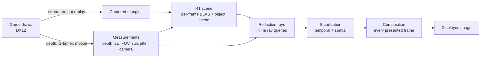

# How URTI works

URTI adds ray-traced reflections to DirectX 12 games that were never written for ray tracing. It knows nothing about
the game in advance: no source code, no shader replacement, no asset extraction. Everything it needs (geometry, camera,
sun, materials) is observed or measured while the game runs, frame after frame. This document walks through the whole
chain, from the game's draw calls to the final pixel.

The detailed log of every experiment, measurement and dead end is [JOURNAL.md](JOURNAL.md).

## 1. Running inside the game

URTI is a [ReShade](https://reshade.me) 6.8 add-on (`urti.addon64`). ReShade loads it next to the game and lets it see
every Direct3D 12 call: pipeline creation, draws, resource barriers, presents. URTI only works on the device that
presents the image; games often create several.

D3D12 refuses stream output unless the root signature allows it. URTI therefore adds
`D3D12_ROOT_SIGNATURE_FLAG_ALLOW_STREAM_OUTPUT` to the game's root signatures when they are created.

## 2. Geometry: replaying the game's draws

URTI does not decode vertex buffers. Formats, compression and GPU skinning vary from engine to engine. Instead, each
game pipeline gets a **shadow pipeline**: the same vertex shader and root signature, stream output of `SV_Position`, and
no rasterisation. Each draw on the main screen is replayed once with it, then the game's state is restored. The result
is every triangle exactly as the game transformed it, with animation, instancing and compressed vertices already
applied.

- **Tessellation.** Pipelines with hull and domain shaders (Red Dead Redemption 2's terrain) are replayed with them, and
  the position is taken after the domain shader (`tess=1`). Their output size is unknown in advance, so it is learned
  per mesh.
- **Identities and budget.** A draw is identified by its mesh signature, not by its instance count, which changes
  every frame for vegetation. A per-frame vertex budget is regulated against the measured cost of building the
  acceleration structure. Large repeated meshes (grass, foliage) are sampled in parts.
- **Persistent places.** Each object keeps a fixed region of the capture buffer from one frame to the next. Objects
  that come and go therefore do not shuffle the scene, which used to cause one-frame flashes.
- **Transparent layer.** Water and glass are captured separately (`water=1`). They become the reflecting surface, not
  an obstacle.

Coverage was checked by rasterising the captured triangles again: they reproduce **97.5 to 97.6 %** of Red Dead
Redemption 2's depth buffer, and **99.8 %** on the synthetic bench.

## 3. The RT scene

- **Per-frame structure.** The geometry captured this frame, which is near and possibly moving, is rebuilt every
  frame into one bottom-level structure, in the camera space of that frame.
- **Object cache.** Static objects get their own bottom-level structure, kept in a 1 GB ring and placed with the
  camera's motion. Objects behind the camera or off screen keep reflecting.
- **Alpha-tested foliage.** The captured triangles of leaves are full cards. A ray that hits a card where the camera
  sees through it, or where the sun's shadow map sees through it, steps on to the next hit.

Rays use DXR 1.1 inline ray queries in compute shaders. There is no ray-tracing pipeline or shader table.

## 4. Measuring what the game does not tell

| Quantity | How it is obtained |
|---|---|
| Depth law (`z = A + B / w`) | fitted on captured vertices every frame |
| Field of view | Red Dead Redemption 2: shadow-cascade pairs between two frames give the stretch of URTI's assumed projection (s², t²); corrected only when the camera is still and the measurement stable, then stored (`fov_v` in `urti_calib.ini`). Read from the game's camera when one is found |
| Sun direction | each mesh drawn both on screen and in the sun's shadow map gives an affine map between the two; their vote gives the sun |
| Sub-pixel jitter (DLSS / TAA) | the shear it adds to the frame-to-frame motion of the cascades |
| Camera motion | measured on URTI's own geometry, or read from the game's camera when found |
| Camera orientation in the world | Red Dead Redemption 2: world-space G-buffer normals against depth normals, solved every frame with Horn's method |
| Game camera (when available) | found by scanning constant buffers for a matrix that matches the depth (`camera_cb=`) |

The field of view matters more than it looks. URTI's ray intersections stay correct in a stretched camera space,
because the geometry and the pixels are stretched alike. But every angle is wrong: the floor's normal, the reflection's
direction. From version 74 to 104, Red Dead Redemption 2 ran with the assumed 50° instead of its measured 38°, and the
reflections seemed to float. Version 105 fixed that.

## 5. Materials: which pixels reflect

URTI reads the game's G-buffer. A pass survey lists every render target of a frame and identifies its layout once per
game.

| | Red Dead Redemption 2 |
|---|---|
| Smoothness | material target, green channel |
| Normals | target 1, world space, alpha marks characters |
| Material type | material target, red channel (foliage, skin, common) |
| Metalness | material target, blue channel |
| Water | smooth, flat, horizontal |

A pixel receives a ray-traced reflection when all of these hold:

1. **Mirror class.** Its smoothness is above `smooth_min`.
2. **Flat.** It lies on a flat surface: neighbours 2 pixels away are aligned. This excludes hair, leaves and faces,
   whose depth-derived normals are noise.
3. **Extended.** At least 5 of its 8 neighbours are smooth too. An isolated smooth pixel (a rail, a cobblestone edge)
   would flicker as its normal changes with the jitter.
4. **Visible enough.** Its Fresnel weight is worth a ray (≥ 3 %).

**Glossy floors** (optional, `gloss_min=`, off by default). Red Dead Redemption 2's floors are smooth but below the
mirror threshold. When enabled, they get a blurred reflection only if they are a floor (world normal pointing up), not
foliage or skin, and closer than 10 to 18 m (the reflection fades out over that range). The blur follows the material's lobe: half-angle α = roughness², and footprint =
hit distance × α / (eye distance + hit distance), read with 8 taps on a Vogel disk. A first version without this sorting
put reflections on 20 % of the screen, which was too much. Even sorted, a blurred sheen on dry pavement read as lower
quality than sharp mirrors, so it stays off.

**Water** can use the world's up vector as its normal: the depth-derived normal of a rippled surface changes every
frame.

## 6. Tracing reflections

For each reflecting pixel, the ray follows the mirror direction (Schlick Fresnel, F0 = 0.04). Where it lands decides
where the colour comes from:

- **Visible on screen.** The colour is read in the presented image at the reflected point's position. This is the
  game's own shading, so lights, shadows and fog are exact.
- **Hidden or off screen.** The colour comes from a **world-space radiance cache**: a spatial hash after NVIDIA's
  SHaRC, 2²³ entries, filled from what the screen has shown, with one jittered lookup per ray. Holes in foliage are
  learned there too. Without the game's camera, the colour comes from per-triangle and per-object colours learned the
  same way.
- **Nothing hit.** A sky map (octahedral), learned from the screen, provides the colour.

A time budget (`refl_ms`, 3.5 ms) is checked every frame on the median of the last 9 frames. When it is exceeded,
reflections switch to one pixel in two, take fewer hops through foliage, then a shorter range. They come back slowly.

## 7. Stabilisation

The reflected colour is resolved at render resolution:

- **Soft sampling.** It is sampled over a small rotated grid rather than at a single point. A mirror read at one pixel
  shimmered on thin branches as the jitter moved.
- **Highlight cap.** Its luminance is capped, so no isolated white sparks appear.
- **Virtual-image motion.** The history is reprojected with the motion of the reflected point, not of the surface: the
  rotation part plus the translation part scaled by the hit distance.
- **Clamping.** The history is clamped to the current neighbourhood and mixed spatially.

## 8. Composition on every presented frame

With frame generation (DLSS-G), half of the presented frames were never rendered by the game. URTI composes on every
presented frame:

- **Generated frames.** Effects are shifted by a fraction of the motion (`fg_shift`).
- **Layer queue.** A queue of three effect layers, keyed by the game frame they belong to, lays the right layer on the
  right image (`lag=1`). Without it, the layer sat one frame off and the reflection jerked.
- **Interface.** When the game provides an image without its UI (the frame-generation input), a mask keeps the interface
  untouched. Otherwise a fixed screen zone is protected (Red Dead Redemption 2's minimap, `ui_zone`).
- **HDR10.** It is decoded from PQ, blended in linear light, and encoded back.

## 9. Optional: ray-traced ambient occlusion

The occlusion pass is still in the code and can be enabled (`UrtiOcclusion` in the effect, `ao=` in `urti.ini`). It is
**off by default**: in play it was judged not worth its artefacts and its cost. What it implements:

- **Rays.** Contact rays (2.5 m) plus long rays (16 m) toward the sky, counted only above the horizon and weighted by
  elevation. One quarter of the pixels is computed each frame, and moving pixels in a checkerboard.
- **Normals and exclusions.** It uses the game's G-buffer normals. Characters and foliage are excluded, both as
  receivers and as occluders.
- **Sun.** An RT ray toward the sun decides whether a point is sunlit, so that only sky light is removed.
- **Denoiser.** A dual history, in the spirit of NVIDIA's ReBLUR: a fast history (2 to 3 frames) bounds a slow one.
  Ray directions use low-discrepancy sampling (interleaved gradient noise).

## 10. Measuring instead of guessing

Every change is judged in the game, at real pace, against the same frame without URTI:

- **Bursts** (F8, or a trigger file). 30 frames saved before and after URTI's composition. `tools/analyse/burst_noise.py`
  reports the flicker URTI adds on top of the game's own.
- **Alignment and stability.** `tools/analyse/alignment.py` uses phase correlation at a tenth of a pixel. It reports
  whether an effect follows the image (1: attached, 0: frozen), any fixed offset, and the residual instability after
  realignment.
- **Trails.** `tools/analyse/trails.py` measures, while the camera turns, how much of an effect lags behind.
- **Films.** Kept in GPU memory at real pace and compared with NVIDIA's
  [FLIP](https://github.com/NVlabs/flip).
- **Regressions.** The same session is replayed on old builds, so a change can be compared with what came before.

## 11. Lessons

- **Measure the camera.** A wrong field of view breaks every angle while every intersection still looks right.
- **Watch for silent fallbacks.** The calibration silently reset the field of view, and a stored calibration once
  picked the wrong shadow map. The sun was then lost for twenty versions.
- **Classify with the game's data.** The G-buffer knows what is skin, foliage, metal or water. Guessing from depth or
  colour costs both quality and time.
- **Measure flicker and trails separately.** An effect can pass a flicker test and still smear in motion.

## Limits

- **Per-game profile.** Each game needs a small settings profile: material slots and, when available, the camera's
  constant buffer.
- **Unsupported draws.** Mesh-shader draws are not captured, and neither are some tessellated passes (those that do
  not write the screen depth).
- **Colours of hidden points.** A reflected point the screen has never shown has an approximate colour (learned per
  object, or from the cache).
- **Single player only.** URTI injects itself into the game's rendering.
