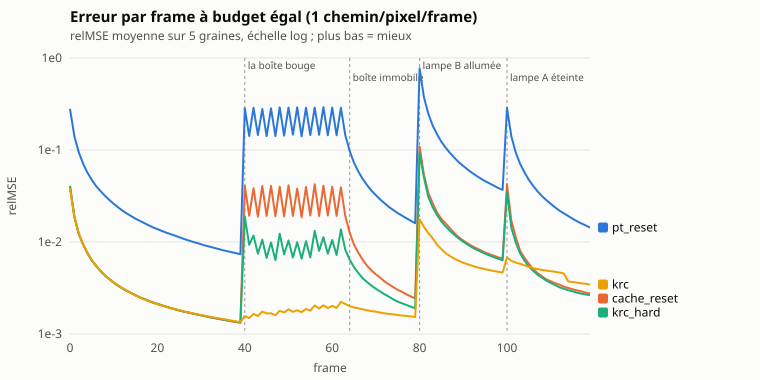
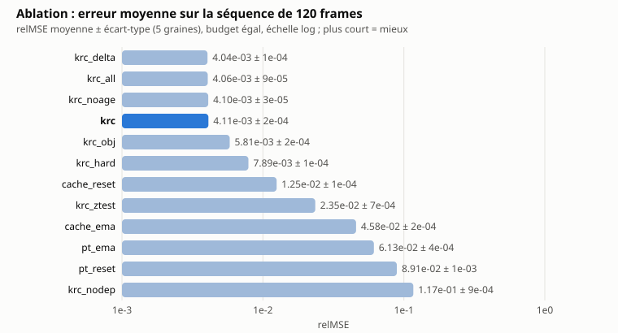
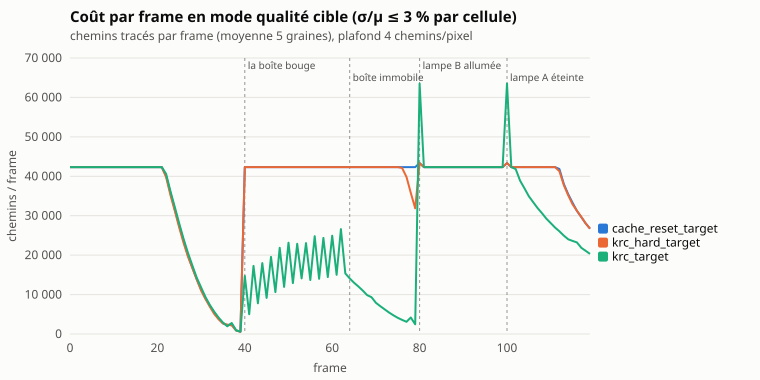
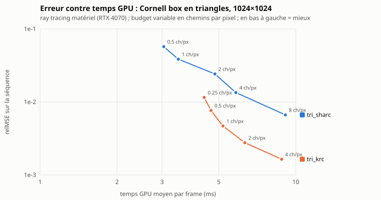

# Résultats

Prototype Rust, traceur CPU ou GPU (wgpu/Vulkan, résultats identiques statistiquement),
scène diffuse de boîtes, 192×96 px. Tous les chiffres sont des
**relMSE** contre une référence à 4096 spp par pixel, en moyenne ± écart-type sur
**5 graines** (3 pour le passage à l'échelle). Budget égal pour toutes les méthodes :
1 chemin par pixel de surface et par frame. Les chemins différentiels sont comptés et
remboursés sur les frames suivantes. Reproduire : `cargo run --release -- all`, puis
`cargo run --release -- scale` et `python tools/plots.py`.

## TL;DR

1. **À budget égal, KRC divise l'erreur par 3 par rapport au meilleur cache classique et
   par 21 par rapport au path tracing accumulé** sur une séquence dynamique (4,1e-3
   contre 1,25e-2 et 8,9e-2).
2. **Une scène statique ne coûte quasiment plus rien** : en mode qualité cible, on
   tombe à ~0,01 chemin/pixel/frame une fois convergé, soit le plancher
   d'exploration.
3. **Le coût d'un objet qui bouge suit le changement, pas la taille de la scène.**
   De 2 à 8 pièces, le coût de KRC pendant que la boîte bouge *baisse* (16 k → 10 k
   chemins/frame), alors que le cache avec reset passe de 42 k à 165 k (∝ N).
4. **Ce qui fait la différence n'est pas le graphe de dépendances** : c'est la
   **mise à jour différentielle par chemins corrélés**. Le graphe ne réduit que le coût,
   et seulement pour les changements localisés.
5. **Les changements de lumière deviennent locaux grâce aux dépendances pondérées par
   l'énergie** (§3 bis). À 8 pièces, allumer une lampe coûte 28 k chemins au lieu de 56 k,
   et ce coût ne croît plus avec la scène au-delà des pièces réellement éclairées.
6. **Tout le pipeline tourne sur GPU** (RTX 4070), validé contre le CPU, stable sur
   12 000 frames (§7, §8).
7. **Sur de vrais triangles avec ray tracing matériel** (Cornell box), à temps GPU égal,
   KRC a **2,4 à 2,9× moins d'erreur** que le cache SHaRC-like, et à erreur égale il est
   ~2× plus rapide. Contrepartie : des pics de 12 à 16 ms les frames d'événement (§9).
8. **Échecs documentés** : le z-test de vérification (sous-puissant), les dépendances
   « objets touchés » de l'idée initiale (faux négatifs à l'allumage d'une lampe), le
   graphe binaire face à la lumière (il sature au fil des portes), deux tentatives de
   pondération (sketch haché, fréquences de traversée), et l'amortissement simple des
   événements de lampe.

## 1. Séquence principale (2 pièces, 120 frames)

| Méthode | Séquence | Statique | Boîte bouge | Lampe B allumée | Lampe A éteinte |
|---|---|---|---|---|---|
| `pt_reset` (accumulation par pixel, reset) | 8,9e-2 | 8,3e-3 | 2,2e-1 | 1,4e-1 | 5,1e-2 |
| `pt_ema` (accumulation temporelle) | 6,1e-2 | 1,5e-2 | 3,5e-2 | 6,8e-2 | 1,7e-1 |
| `cache_ema` (type SHaRC/DDGI) | 4,6e-2 | 2,3e-3 | 4,5e-3 | 5,0e-2 | 2,1e-1 |
| `cache_reset` (Neyman + reset oracle) | 1,25e-2 | 1,45e-3 | 3,0e-2 | 2,0e-2 | 7,1e-3 |
| `krc_hard` (dépendances, invalidation dure) | 7,9e-3 | 1,45e-3 | 9,6e-3 | 1,8e-2 | 6,3e-3 |
| `krc_obj` (dépendances « objets touchés », H0) | 5,8e-3 | 1,42e-3 | 1,8e-3 | 1,4e-2 | 8,8e-3 |
| **`krc`** (H\*\* complet) | **4,1e-3** | 1,47e-3 | **1,8e-3** | **7,6e-3** | 4,8e-3 |
| `krc_all` (delta partout, sans graphe) | 4,1e-3 | 1,46e-3 | 1,9e-3 | 7,8e-3 | 4,3e-3 |

Lecture :

- **Le cache avec allocation de Neyman** fait déjà mieux que l'accumulation par pixel en
  statique (1,45e-3 contre 8,3e-3) : la variance va là où elle compte. Le cache garde un
  biais de discrétisation (cellules de 2 à 4 px) : après un long préchauffage, le
  plancher est d'environ 6e-4 à 7e-4.
- **Delta contre invalidation dure** : 5× moins d'erreur pendant que la boîte bouge, 2,4×
  à l'allumage. Garder l'historique et le corriger vaut beaucoup plus que le jeter.
- **Dépendances spatiales contre « objets touchés »** : à l'allumage d'une lampe, H0
  rate les cellules (la lampe éteinte n'était jamais échantillonnée), d'où 1,4e-2
  contre 7,6e-3. La critique du §1.1 de [HYPOTHESE.md](HYPOTHESE.md) est confirmée.
- `krc_ztest` (2,35e-2) et `krc_nodep` (1,17e-1) : un test statistique sur échantillons
  indépendants ne remplace pas une mesure corrélée, et sans aucune détection
  d'événement l'historique reste périmé.
- Après l'extinction de A, KRC reste légèrement au-dessus de l'invalidation dure en
  fin de séquence. Ce n'est pas un biais (|biais| < 0,6 %) mais de la variance dans
  la pièce devenue sombre (voir JOURNAL v3) : quand l'historique devient inutile, les
  chemins corrélés coûtent plus cher qu'un redémarrage.

## 2. Coût en mode qualité cible

L'allocateur n'échantillonne que les cellules dont l'erreur relative prédite dépasse
3 %, avec un plafond de 4 chemins/pixel.

| Méthode | Chemins/frame (moy.) | relMSE |
|---|---|---|
| `cache_reset_target` | 37 500 | 3,8e-3 |
| `krc_hard_target` | 37 300 | 2,8e-3 |
| **`krc_target`** | **26 700** | **2,1e-3** |

Avec 29 % de chemins en moins, l'erreur baisse de 44 %. En statique, le coût tombe
de 42 k à ~300 chemins/frame (frames 20 à 39).

## 3. Passage à l'échelle (2, 4, 8 pièces)

Densité de pixels constante (96 px de large par pièce). Les événements touchent
toujours les pièces 0 et 1. Préchauffage de 150 frames.

| Mode qualité cible, chemins/frame | N = 2 | N = 4 | N = 8 |
|---|---|---|---|
| Statique (cache convergé) | 270 | 400 | 710 (≈ 0,01/px) |
| Boîte bouge, `cache_reset_target` | 42 k | 83 k | 165 k |
| Boîte bouge, `krc_all_target` | 18 k | 18 k | 19 k |
| Boîte bouge, **`krc_target`** | **16 k** | **14 k** | **10 k** |
| Lampes, `krc_target` | 31 à 43 k | 52 à 66 k | 39 à 48 k |

Coût direct d'un événement (chemins corrélés) :

| Chemins corrélés par événement | N = 2 | N = 4 | N = 8 |
|---|---|---|---|
| Déplacement, `krc_all` (sans graphe) | 10,7 k | 14,3 k | 20,7 k |
| Déplacement, **`krc`** | **8,4 k** | **7,0 k** | **4,9 k** |
| Lampe B allumée, `krc_all` | 23,6 k | 41,3 k | 71,2 k |
| Lampe B allumée, `krc` | 20,1 k | 34,9 k | 56,1 k |

Erreur à budget égal, toutes phases : à N = 8, `krc` obtient 1,6e-3, contre 1,8e-2 pour
`cache_reset` et 4,7e-3 pour `krc_hard`.

Lecture :

- **Pour la géométrie, la promesse tient** : le graphe de dépendances limite le coût à
  la zone affectée, et ce coût ne croît pas avec la scène. Le **vieillissement** des
  dépendances (fenêtre de 64 échantillons) réduit encore les suspects : 1 070 contre
  1 837 sans vieillissement à N = 8.
- **Pour la lumière, elle ne tient pas encore.** La lampe de la pièce B éclaire
  réellement, à travers la porte, les murs des pièces 0 et 2. Les cellules des pièces
  suivantes dépendent de ces murs par des chemins indirects fréquents. Le graphe a
  donc raison qualitativement : ces cellules changent bien. Mais il ne sait pas que le
  changement y est minuscule. Il manque une **propagation pondérée par l'énergie**.

## 3 bis. Dépendances pondérées par l'énergie

Vérité terrain (références, N = 8, changement signé agrégé par pièce) quand la lampe B
s'allume : pièces 0 à 3 = +4,1 %, +153 %, +165 %, +1,1 % ; pièces 4 à 7 < 0,1 %.

Le critère : une cellule est suspecte si ses chemins traversent la zone changée **et** si
Σ_S f_S · M_S > 1 % de sa radiance, où f_S est la fraction de ses échantillons récents
ayant un **sommet** dans la super-région S (là où la lumière est captée), et M_S la
variation de radiance déposée par les sondes de la lampe.

| N = 8, suspects par pièce (lampe B allumée) | 0 | 1 | 2 | 3 | 4 | 5 | 6 | 7 |
|---|---|---|---|---|---|---|---|---|
| Graphe binaire (`krc`) | 85 % | 83 % | 82 % | 78 % | 77 % | 74 % | 76 % | 78 % |
| **Pondéré (`krc_energy`)** | 100 % | 100 % | 94 % | 53 % | 8 % | 1,5 % | 0,3 % | 0,6 % |

| Chemins corrélés par allumage | N = 2 | N = 4 | N = 8 |
|---|---|---|---|
| `krc_all` (sans graphe) | 23,6 k | 41,3 k | 71,2 k |
| `krc` (binaire) | 20,1 k | 34,9 k | 56,1 k |
| **`krc_energy`** | 20,1 k | 32,8 k | **27,7 k** |

L'erreur reste équivalente : 3,99e-3 contre 4,11e-3 en séquence principale, et 1,57e-3
contre 1,61e-3 à N = 8. Mémoire : 72 octets de compteurs par cellule.

## 4. Verdict sur l'hypothèse

| Affirmation de départ | Verdict |
|---|---|
| Une scène statique converge et finit par ne plus rien coûter | ✅ ~0,01 chemin/pixel/frame (plancher d'exploration) |
| Gagne contre un cache temps réel standard, en ms, sur de vrais triangles | ✅ 2,4–2,9× moins d'erreur à temps moyen égal ; ⚠️ pics de 12–16 ms les frames d'événement |
| Le coût d'une scène dynamique suit ce qui change, pas la taille de la scène | ✅ pour les objets ; ✅ pour la lumière avec la pondération par l'énergie (le coût suit la zone réellement éclairée) |
| Le graphe de dépendances par objets touchés suffit | ❌ faux négatifs (lampe allumée, nouvelle ombre) ; les régions traversées le battent |
| Invalider les cellules dépendantes | ⚠️ invalider coûte cher ; **mesurer le delta par chemins corrélés et corriger** est 2 à 5× meilleur |
| Allouer les rayons vers l'incertitude | ✅ Neyman + a priori bayésien ; l'a priori doit avoir un plancher (bug de famine trouvé) |

## 5. Limites du prototype

- Scène jouet : boîtes alignées sur les axes, matériaux diffus uniquement, basse
  résolution. Le traçage tourne sur GPU, mais le cache et l'allocation restent sur CPU.
- Caméra fixe : pas de reprojection ni de désocclusion par la caméra.
- Le cache affiche une radiance moyennée par cellule (biais de discrétisation d'environ
  6e-4 relMSE) ; un rendu final ajouterait l'éclairage direct par pixel.
- Mémoire par cellule : 2 × 432 octets de bitset de régions (grille de 8 pièces) + 3
  accumulateurs. C'est beaucoup ; une version sérieuse utiliserait un filtre de Bloom
  ou des régions hiérarchiques.

## 6. Pistes suivantes, par ordre de valeur attendue

1. ~~Dépendances pondérées par l'énergie~~ : fait (§3 bis).
2. **Cache résident GPU** : voir [FEUILLE_DE_ROUTE.md](FEUILLE_DE_ROUTE.md).
3. **Choisir entre delta et redémarrage avant de payer** : quand l'historique devient
   inutile (lampe dominante éteinte), les chemins corrélés coûtent plus cher qu'un
   redémarrage. Le β de la variable de contrôle se prédit à partir des m₀ premiers
   chemins.
4. **Spéculaire** : tracer à travers les surfaces brillantes jusqu'au premier sommet
   diffus (comme NRC/SHaRC), et mesurer ce que cela coûte à la promesse.
5. **Caméra mobile**, puis rayons matériels (cœurs RT).

## 7. GPU (RTX 4070, wgpu sur Vulkan)

`cargo run --release -- bench` ; séquence complète : `KRC_GPU=1 cargo run --release -- all`
(résultats dans `results/gpu`).

- **Exactitude** : à 256 spp, l'écart GPU/CPU (relMSE 2,315e-3) égale le bruit CPU/CPU
  (2,306e-3) ; la luminance moyenne est à 0,14 % près.
- **Chemins corrélés exacts sur GPU** : |L + ΔL − L_ancien| ≤ 2e-7 (précision f32).
- **Séquence complète sur GPU** : mêmes conclusions que sur CPU, dans les barres d'erreur
  (`krc_energy` 3,96e-3, `cache_reset` 1,25e-2, `pt_reset` 8,96e-2).

| Débit (transferts compris) | CPU 16 cœurs | GPU | Gain |
|---|---|---|---|
| 2,07 M chemins (1080p, 1 spp), sans dépendances | 1 129 ms | 107 ms | ×10,5 |
| 2,07 M chemins, avec dépendances | 1 400 ms | 919 ms | ×1,5 |
| Calcul pur (64 spp par requête) | — | 523 M chemins/s | — |

Le calcul pur ferait tenir 2 M chemins en ~4 ms. Ce qui coûte, ce sont les transferts :
avec dépendances, chaque chemin renvoie ~450 octets au CPU. D'où la prochaine étape :
le cache doit vivre sur le GPU.

## 8. Pipeline entièrement GPU

Tout vit sur le GPU : G-buffer, table de hachage des cellules, événement, chemins
corrélés, allocation, traçage, résolution, affichage. Le CPU envoie la scène et
l'événement, puis relit l'image pour l'évaluation seulement, hors chronométrage.

| Pièces en enfilade, 1 chemin/px, temps GPU médian | Statique | Boîte qui bouge | Pic d'allumage |
|---|---|---|---|
| `gpu_sharc` 1920×960 | 3,8 ms | 3,8 ms | 3,8 ms |
| `gpu_krc` 1920×960 | 4,6 ms | 7,0 ms | 10,7 ms |

- Qualité identique au CPU : `gpu_krc` 4,19e-3 contre 4,11e-3 pour `krc_energy_l2`.
- **Dérive longue** (12 000 frames) : aucune dérive mesurable après deux correctifs
  (poids max d'une estimation corrigée, historique plafonné à 1 024), `results/gpu/drift.txt`.

## 9. Triangles et ray tracing matériel : comparaison en ms contre SHaRC

Cornell box en triangles, ray query Vulkan sur la RTX 4070, même séquence de 120 frames.

| 256×256, 5 graines | Séquence | Statique | Boîte | Lampe allumée | Lampe éteinte |
|---|---|---|---|---|---|
| `tri_sharc` | 3,91e-2 | 2,02e-3 | 8,80e-3 | 3,86e-2 | 1,66e-1 |
| **`tri_krc`** | **5,03e-3** | **1,38e-3** | **2,48e-3** | **8,75e-3** | **7,01e-3** |

| 1024×1024 | Budget | relMSE | GPU moyen | GPU médian | p95 |
|---|---|---|---|---|---|
| SHaRC | 4 chemins/px | 1,35e-2 | 5,8 ms | 5,8 ms | 6,4 ms |
| SHaRC | 8 chemins/px | 6,7e-3 | 9,1 ms | 9,0 ms | 9,7 ms |
| **KRC** | 1 chemin/px | **4,7e-3** | **5,2 ms** | 4,2 ms | 13,1 ms |
| **KRC** | 2 chemins/px | **2,8e-3** | 6,3 ms | 5,4 ms | 13,7 ms |

- **À temps moyen égal, KRC a 2,4 à 2,9× moins d'erreur ; à erreur égale, il est ~2×
  plus rapide.**
- **Mais le temps de KRC n'est pas constant.** Les frames d'événement coûtent 12 ms (pas
  de boîte) à 16 ms (lampe), parce que dans une seule pièce tout change vraiment et que
  chaque cellule reçoit ses chemins corrélés dans la frame. SHaRC a un coût plat.
- Amortir les événements de lampe sur plusieurs frames divise bien le pic par deux, mais
  l'erreur augmente de 2,5× (cellules périmées affichées) : résultat négatif.
