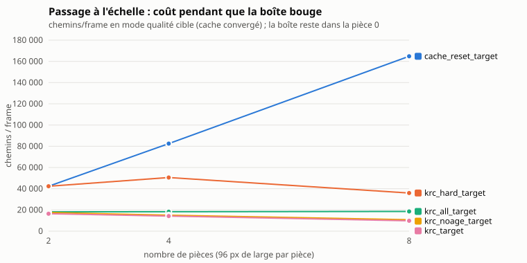
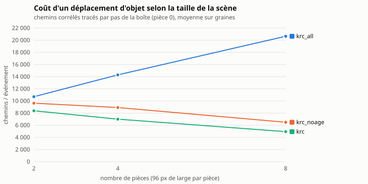

# Résultats

Prototype CPU (Rust), scène diffuse de boîtes, 192×96 px. Tous les chiffres sont des
**relMSE** contre une référence à 4096 spp par pixel, en moyenne ± écart-type sur
**5 graines** (3 pour le passage à l'échelle). Budget égal pour toutes les méthodes :
1 chemin par pixel de surface et par frame. Les chemins différentiels sont comptés et
remboursés sur les frames suivantes. Reproduire : `cargo run --release -- all`, puis
`cargo run --release -- scale` et `python tools/plots.py`.

## TL;DR

1. **À budget égal, KRC divise l'erreur par 3 par rapport au meilleur cache classique et
   par 21 par rapport au path tracing accumulé** sur une séquence dynamique (4,1e-3
   contre 1,25e-2 et 8,9e-2).
2. **Une scène statique ne coûte quasiment plus rien** : en mode qualité cible, on
   tombe à ~0,01 chemin/pixel/frame une fois convergé, soit le plancher
   d'exploration.
3. **Le coût d'un objet qui bouge suit le changement, pas la taille de la scène.**
   De 2 à 8 pièces, le coût de KRC pendant que la boîte bouge *baisse* (16 k → 10 k
   chemins/frame), alors que le cache avec reset passe de 42 k à 165 k (∝ N).
4. **Ce qui fait la différence n'est pas le graphe de dépendances** : c'est la
   **mise à jour différentielle par chemins corrélés**. Le graphe ne réduit que le coût,
   et seulement pour les changements localisés.
5. **Échecs documentés** : le z-test de vérification (sous-puissant), les dépendances
   « objets touchés » de l'idée initiale (faux négatifs à l'allumage d'une lampe), et
   le graphe binaire face aux changements de lumière (il sature au fil des portes).

## 1. Séquence principale (2 pièces, 120 frames)

| Méthode | Séquence | Statique | Boîte bouge | Lampe B allumée | Lampe A éteinte |
|---|---|---|---|---|---|
| `pt_reset` (accumulation par pixel, reset) | 8,9e-2 | 8,3e-3 | 2,2e-1 | 1,4e-1 | 5,1e-2 |
| `pt_ema` (accumulation temporelle) | 6,1e-2 | 1,5e-2 | 3,5e-2 | 6,8e-2 | 1,7e-1 |
| `cache_ema` (type SHaRC/DDGI) | 4,6e-2 | 2,3e-3 | 4,5e-3 | 5,0e-2 | 2,1e-1 |
| `cache_reset` (Neyman + reset oracle) | 1,25e-2 | 1,45e-3 | 3,0e-2 | 2,0e-2 | 7,1e-3 |
| `krc_hard` (dépendances, invalidation dure) | 7,9e-3 | 1,45e-3 | 9,6e-3 | 1,8e-2 | 6,3e-3 |
| `krc_obj` (dépendances « objets touchés », H0) | 5,8e-3 | 1,42e-3 | 1,8e-3 | 1,4e-2 | 8,8e-3 |
| **`krc`** (H\*\* complet) | **4,1e-3** | 1,47e-3 | **1,8e-3** | **7,6e-3** | 4,8e-3 |
| `krc_all` (delta partout, sans graphe) | 4,1e-3 | 1,46e-3 | 1,9e-3 | 7,8e-3 | 4,3e-3 |

Lecture :

- **Le cache avec allocation de Neyman** fait déjà mieux que l'accumulation par pixel en
  statique (1,45e-3 contre 8,3e-3) : la variance va là où elle compte. Le cache garde un
  biais de discrétisation (cellules de 2 à 4 px) : après un long préchauffage, le
  plancher est d'environ 6e-4 à 7e-4.
- **Delta contre invalidation dure** : 5× moins d'erreur pendant que la boîte bouge, 2,4×
  à l'allumage. Garder l'historique et le corriger vaut beaucoup plus que le jeter.
- **Dépendances spatiales contre « objets touchés »** : à l'allumage d'une lampe, H0
  rate les cellules (la lampe éteinte n'était jamais échantillonnée), d'où 1,4e-2
  contre 7,6e-3. La critique du §1.1 de [HYPOTHESE.md](HYPOTHESE.md) est confirmée.
- `krc_ztest` (2,35e-2) et `krc_nodep` (1,17e-1) : un test statistique sur échantillons
  indépendants ne remplace pas une mesure corrélée, et sans aucune détection
  d'événement l'historique reste périmé.
- Après l'extinction de A, KRC reste légèrement au-dessus de l'invalidation dure en
  fin de séquence. Ce n'est pas un biais (|biais| < 0,6 %) mais de la variance dans
  la pièce devenue sombre (voir JOURNAL v3) : quand l'historique devient inutile, les
  chemins corrélés coûtent plus cher qu'un redémarrage.

## 2. Coût en mode qualité cible

L'allocateur n'échantillonne que les cellules dont l'erreur relative prédite dépasse
3 %, avec un plafond de 4 chemins/pixel.

| Méthode | Chemins/frame (moy.) | relMSE |
|---|---|---|
| `cache_reset_target` | 37 500 | 3,8e-3 |
| `krc_hard_target` | 37 300 | 2,8e-3 |
| **`krc_target`** | **26 700** | **2,1e-3** |

Avec 29 % de chemins en moins, l'erreur baisse de 44 %. En statique, le coût tombe
de 42 k à ~300 chemins/frame (frames 20 à 39).

## 3. Passage à l'échelle (2, 4, 8 pièces)

Densité de pixels constante (96 px de large par pièce). Les événements touchent
toujours les pièces 0 et 1. Préchauffage de 150 frames.

| Mode qualité cible, chemins/frame | N = 2 | N = 4 | N = 8 |
|---|---|---|---|
| Statique (cache convergé) | 270 | 400 | 710 (≈ 0,01/px) |
| Boîte bouge, `cache_reset_target` | 42 k | 83 k | 165 k |
| Boîte bouge, `krc_all_target` | 18 k | 18 k | 19 k |
| Boîte bouge, **`krc_target`** | **16 k** | **14 k** | **10 k** |
| Lampes, `krc_target` | 31 à 43 k | 52 à 66 k | 39 à 48 k |

Coût direct d'un événement (chemins corrélés) :

| Chemins corrélés par événement | N = 2 | N = 4 | N = 8 |
|---|---|---|---|
| Déplacement, `krc_all` (sans graphe) | 10,7 k | 14,3 k | 20,7 k |
| Déplacement, **`krc`** | **8,4 k** | **7,0 k** | **4,9 k** |
| Lampe B allumée, `krc_all` | 23,6 k | 41,3 k | 71,2 k |
| Lampe B allumée, `krc` | 20,1 k | 34,9 k | 56,1 k |

Erreur à budget égal, toutes phases : à N = 8, `krc` obtient 1,6e-3, contre 1,8e-2 pour
`cache_reset` et 4,7e-3 pour `krc_hard`.

Lecture :

- **Pour la géométrie, la promesse tient** : le graphe de dépendances limite le coût à
  la zone affectée, et ce coût ne croît pas avec la scène. Le **vieillissement** des
  dépendances (fenêtre de 64 échantillons) réduit encore les suspects : 1 070 contre
  1 837 sans vieillissement à N = 8.
- **Pour la lumière, elle ne tient pas encore.** La lampe de la pièce B éclaire
  réellement, à travers la porte, les murs des pièces 0 et 2. Les cellules des pièces
  suivantes dépendent de ces murs par des chemins indirects fréquents. Le graphe a
  donc raison qualitativement : ces cellules changent bien. Mais il ne sait pas que le
  changement y est minuscule. Il manque une **propagation pondérée par l'énergie**.

## 4. Verdict sur l'hypothèse

| Affirmation de départ | Verdict |
|---|---|
| Une scène statique converge et finit par ne plus rien coûter | ✅ ~0,01 chemin/pixel/frame (plancher d'exploration) |
| Le coût d'une scène dynamique suit ce qui change, pas la taille de la scène | ✅ pour les objets ; ❌ pas encore pour la lumière |
| Le graphe de dépendances par objets touchés suffit | ❌ faux négatifs (lampe allumée, nouvelle ombre) ; les régions traversées le battent |
| Invalider les cellules dépendantes | ⚠️ invalider coûte cher ; **mesurer le delta par chemins corrélés et corriger** est 2 à 5× meilleur |
| Allouer les rayons vers l'incertitude | ✅ Neyman + a priori bayésien ; l'a priori doit avoir un plancher (bug de famine trouvé) |

## 5. Limites du prototype

- Scène jouet : boîtes alignées sur les axes, matériaux diffus uniquement, CPU, basse
  résolution. Rien n'est encore mesuré en ms sur GPU.
- Caméra fixe : pas de reprojection ni de désocclusion par la caméra.
- Le cache affiche une radiance moyennée par cellule (biais de discrétisation d'environ
  6e-4 relMSE) ; un rendu final ajouterait l'éclairage direct par pixel.
- Mémoire par cellule : 2 × 432 octets de bitset de régions (grille de 8 pièces) + 3
  accumulateurs. C'est beaucoup ; une version sérieuse utiliserait un filtre de Bloom
  ou des régions hiérarchiques.

## 6. Pistes suivantes, par ordre de valeur attendue

1. **Dépendances pondérées par l'énergie** : stocker, par région, la fraction des
   échantillons qui la traversent (ou le débit transporté), et donner une magnitude au
   changement (énergie des sondes d'une lampe). On n'invalide plus que si
   fréquence × magnitude dépasse le bruit de la cellule. C'est le critère de
   *Selective Photon Tracing* transposé côté caméra. Objectif : faire passer les lampes
   du ❌ au ✅.
2. **Choisir entre delta et redémarrage avant de payer** : quand l'historique devient
   inutile (lampe dominante éteinte), les chemins corrélés coûtent plus cher qu'un
   redémarrage. Le β de la variable de contrôle se prédit à partir des m₀ premiers
   chemins.
3. **Spéculaire** : tracer à travers les surfaces brillantes jusqu'au premier sommet
   diffus (comme NRC/SHaRC), et mesurer ce que cela coûte à la promesse.
4. **Caméra mobile et port GPU** pour mesurer des millisecondes.
