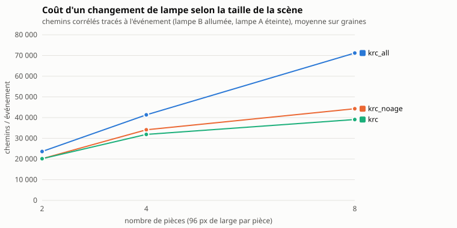
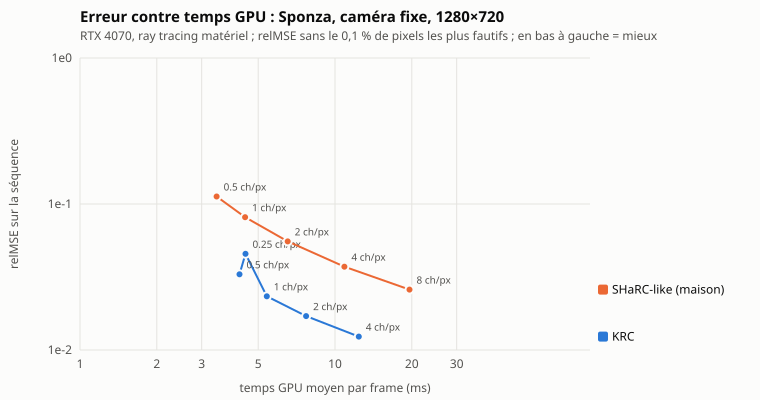
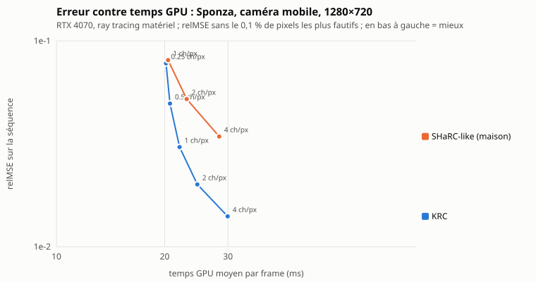
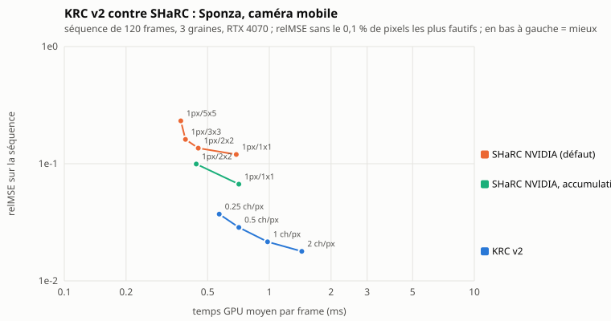
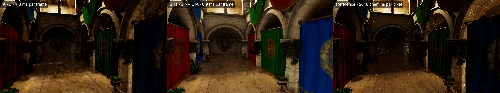
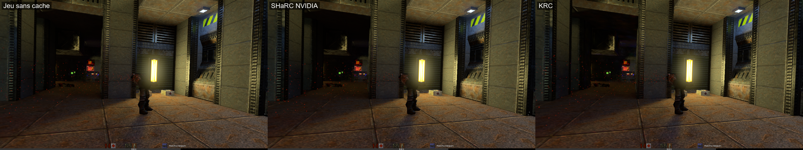
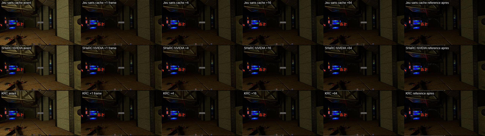

# Résultats

Prototype Rust, traceur CPU ou GPU (wgpu/Vulkan, résultats identiques statistiquement),
scène diffuse de boîtes, 192×96 px. Tous les chiffres sont des
**relMSE** contre une référence à 4096 spp par pixel, en moyenne ± écart-type sur
**5 graines** (3 pour le passage à l'échelle). Budget égal pour toutes les méthodes :
1 chemin par pixel de surface et par frame. Les chemins différentiels sont comptés et
remboursés sur les frames suivantes. Reproduire : `cargo run --release -- all`, puis
`cargo run --release -- scale` et `python tools/plots.py`.

## TL;DR

1. **À budget égal, KRC divise l'erreur par 3 par rapport au meilleur cache classique et
   par 21 par rapport au path tracing accumulé** sur une séquence dynamique (4,1e-3
   contre 1,25e-2 et 8,9e-2).
2. **Une scène statique ne coûte quasiment plus rien** : en mode qualité cible, on
   tombe à ~0,01 chemin/pixel/frame une fois convergé, soit le plancher
   d'exploration.
3. **Le coût d'un objet qui bouge suit le changement, pas la taille de la scène.**
   De 2 à 8 pièces, le coût de KRC pendant que la boîte bouge *baisse* (16 k → 10 k
   chemins/frame), alors que le cache avec reset passe de 42 k à 165 k (∝ N).
4. **Ce qui fait la différence n'est pas le graphe de dépendances** : c'est la
   **mise à jour différentielle par chemins corrélés**. Le graphe ne réduit que le coût,
   et seulement pour les changements localisés.
5. **Les changements de lumière deviennent locaux grâce aux dépendances pondérées par
   l'énergie** (§3 bis). À 8 pièces, allumer une lampe coûte 28 k chemins au lieu de 56 k,
   et ce coût ne croît plus avec la scène au-delà des pièces réellement éclairées.
6. **Tout le pipeline tourne sur GPU** (RTX 4070), validé contre le CPU, stable sur
   12 000 frames (§7, §8).
7. **KRC v2 bat le vrai SHaRC de NVIDIA à temps GPU égal sur les séquences dynamiques**
   (§13) : 2 à 4× moins d'erreur sur Sponza, caméra fixe ou mobile, y compris contre un
   SHaRC réglé pour réagir vite, et 20 à 27× moins sur la Cornell box. KRC v2 reprend à
   SHaRC le rééchantillonnage du cache et garde ses chemins corrélés et sa qualité cible.
   Reste en faveur de SHaRC : le statique avec caméra mobile en 1280×720 (≈2×) et un coût
   minimal plus bas (0,9 ms contre 3 ms en 1280×720).
   *Avant KRC v2* (§12), contre le vrai SHaRC, l'avantage de KRC se réduisait aux
   **changements de lumière** : sur la séquence complète, 3 à 18× moins
   d'erreur, presque entièrement parce que SHaRC garde une lampe éteinte des dizaines de
   frames (7× trop clair). **En statique, caméra fixe ou mobile, SHaRC est aussi bon ou
   meilleur pour 3 à 25× moins de temps GPU.** Les « 2,7 à 2,9× moins d'erreur à temps égal »
   des §9 et §10 étaient mesurés contre mon cache SHaRC-like maison, beaucoup plus coûteux
   que le vrai.
   **Caméra mobile** : la qualité de KRC tient (Sponza 3,8e-2 contre 2,5e-2 caméra fixe),
   mais son coût explose (12,6 ms à 0,25 chemin/px en 1280×720, 1,35 M cellules, ~460 Mo).
8. **Sponza a révélé deux biais vers le sombre** que la relMSE récompensait (§11) :
   l'allocation de Neyman dilue les valeurs rares d'une radiance à queue lourde, et les
   cellules « sans différence mesurée » à l'allumage d'une petite lampe gardaient leur
   historique. Corrigés ; il reste ~3 % de biais statique et un retour plus lent après
   l'extinction de la lampe principale (0,79 → 0,91 en 20 frames, contre 2,45 → 1,56
   pour SHaRC).
9. **Échecs documentés** : le z-test de vérification (sous-puissant), les dépendances
   « objets touchés » de l'idée initiale (faux négatifs à l'allumage d'une lampe), le
   graphe binaire face à la lumière (il sature au fil des portes), deux tentatives de
   pondération (sketch haché, fréquences de traversée), l'amortissement simple des
   événements de lampe, et la part défensive uniforme contre le biais d'allocation.

## 1. Séquence principale (2 pièces, 120 frames)

| Méthode | Séquence | Statique | Boîte bouge | Lampe B allumée | Lampe A éteinte |
|---|---|---|---|---|---|
| `pt_reset` (accumulation par pixel, reset) | 8,9e-2 | 8,3e-3 | 2,2e-1 | 1,4e-1 | 5,1e-2 |
| `pt_ema` (accumulation temporelle) | 6,1e-2 | 1,5e-2 | 3,5e-2 | 6,8e-2 | 1,7e-1 |
| `cache_ema` (type SHaRC/DDGI) | 4,6e-2 | 2,3e-3 | 4,5e-3 | 5,0e-2 | 2,1e-1 |
| `cache_reset` (Neyman + reset oracle) | 1,25e-2 | 1,45e-3 | 3,0e-2 | 2,0e-2 | 7,1e-3 |
| `krc_hard` (dépendances, invalidation dure) | 7,9e-3 | 1,45e-3 | 9,6e-3 | 1,8e-2 | 6,3e-3 |
| `krc_obj` (dépendances « objets touchés », H0) | 5,8e-3 | 1,42e-3 | 1,8e-3 | 1,4e-2 | 8,8e-3 |
| **`krc`** (H\*\* complet) | **4,1e-3** | 1,47e-3 | **1,8e-3** | **7,6e-3** | 4,8e-3 |
| `krc_all` (delta partout, sans graphe) | 4,1e-3 | 1,46e-3 | 1,9e-3 | 7,8e-3 | 4,3e-3 |

Lecture :

- **Le cache avec allocation de Neyman** fait déjà mieux que l'accumulation par pixel en
  statique (1,45e-3 contre 8,3e-3) : la variance va là où elle compte. Le cache garde un
  biais de discrétisation (cellules de 2 à 4 px) : après un long préchauffage, le
  plancher est d'environ 6e-4 à 7e-4.
- **Delta contre invalidation dure** : 5× moins d'erreur pendant que la boîte bouge, 2,4×
  à l'allumage. Garder l'historique et le corriger vaut beaucoup plus que le jeter.
- **Dépendances spatiales contre « objets touchés »** : à l'allumage d'une lampe, H0
  rate les cellules (la lampe éteinte n'était jamais échantillonnée), d'où 1,4e-2
  contre 7,6e-3. La critique du §1.1 de [HYPOTHESE.md](HYPOTHESE.md) est confirmée.
- `krc_ztest` (2,35e-2) et `krc_nodep` (1,17e-1) : un test statistique sur échantillons
  indépendants ne remplace pas une mesure corrélée, et sans aucune détection
  d'événement l'historique reste périmé.
- Après l'extinction de A, KRC reste légèrement au-dessus de l'invalidation dure en
  fin de séquence. Ce n'est pas un biais (|biais| < 0,6 %) mais de la variance dans
  la pièce devenue sombre (voir JOURNAL v3) : quand l'historique devient inutile, les
  chemins corrélés coûtent plus cher qu'un redémarrage.

## 2. Coût en mode qualité cible

L'allocateur n'échantillonne que les cellules dont l'erreur relative prédite dépasse
3 %, avec un plafond de 4 chemins/pixel.

| Méthode | Chemins/frame (moy.) | relMSE |
|---|---|---|
| `cache_reset_target` | 37 500 | 3,8e-3 |
| `krc_hard_target` | 37 300 | 2,8e-3 |
| **`krc_target`** | **26 700** | **2,1e-3** |

Avec 29 % de chemins en moins, l'erreur baisse de 44 %. En statique, le coût tombe
de 42 k à ~300 chemins/frame (frames 20 à 39).

## 3. Passage à l'échelle (2, 4, 8 pièces)

Densité de pixels constante (96 px de large par pièce). Les événements touchent
toujours les pièces 0 et 1. Préchauffage de 150 frames.

| Mode qualité cible, chemins/frame | N = 2 | N = 4 | N = 8 |
|---|---|---|---|
| Statique (cache convergé) | 270 | 400 | 710 (≈ 0,01/px) |
| Boîte bouge, `cache_reset_target` | 42 k | 83 k | 165 k |
| Boîte bouge, `krc_all_target` | 18 k | 18 k | 19 k |
| Boîte bouge, **`krc_target`** | **16 k** | **14 k** | **10 k** |
| Lampes, `krc_target` | 31 à 43 k | 52 à 66 k | 39 à 48 k |

Coût direct d'un événement (chemins corrélés) :

| Chemins corrélés par événement | N = 2 | N = 4 | N = 8 |
|---|---|---|---|
| Déplacement, `krc_all` (sans graphe) | 10,7 k | 14,3 k | 20,7 k |
| Déplacement, **`krc`** | **8,4 k** | **7,0 k** | **4,9 k** |
| Lampe B allumée, `krc_all` | 23,6 k | 41,3 k | 71,2 k |
| Lampe B allumée, `krc` | 20,1 k | 34,9 k | 56,1 k |

Erreur à budget égal, toutes phases : à N = 8, `krc` obtient 1,6e-3, contre 1,8e-2 pour
`cache_reset` et 4,7e-3 pour `krc_hard`.

Lecture :

- **Pour la géométrie, la promesse tient** : le graphe de dépendances limite le coût à
  la zone affectée, et ce coût ne croît pas avec la scène. Le **vieillissement** des
  dépendances (fenêtre de 64 échantillons) réduit encore les suspects : 1 070 contre
  1 837 sans vieillissement à N = 8.
- **Pour la lumière, elle ne tient pas encore.** La lampe de la pièce B éclaire
  réellement, à travers la porte, les murs des pièces 0 et 2. Les cellules des pièces
  suivantes dépendent de ces murs par des chemins indirects fréquents. Le graphe a
  donc raison qualitativement : ces cellules changent bien. Mais il ne sait pas que le
  changement y est minuscule. Il manque une **propagation pondérée par l'énergie**.

## 3 bis. Dépendances pondérées par l'énergie

Vérité terrain (références, N = 8, changement signé agrégé par pièce) quand la lampe B
s'allume : pièces 0 à 3 = +4,1 %, +153 %, +165 %, +1,1 % ; pièces 4 à 7 < 0,1 %.

Le critère : une cellule est suspecte si ses chemins traversent la zone changée **et** si
Σ_S f_S · M_S > 1 % de sa radiance, où f_S est la fraction de ses échantillons récents
ayant un **sommet** dans la super-région S (là où la lumière est captée), et M_S la
variation de radiance déposée par les sondes de la lampe.

| N = 8, suspects par pièce (lampe B allumée) | 0 | 1 | 2 | 3 | 4 | 5 | 6 | 7 |
|---|---|---|---|---|---|---|---|---|
| Graphe binaire (`krc`) | 85 % | 83 % | 82 % | 78 % | 77 % | 74 % | 76 % | 78 % |
| **Pondéré (`krc_energy`)** | 100 % | 100 % | 94 % | 53 % | 8 % | 1,5 % | 0,3 % | 0,6 % |

| Chemins corrélés par allumage | N = 2 | N = 4 | N = 8 |
|---|---|---|---|
| `krc_all` (sans graphe) | 23,6 k | 41,3 k | 71,2 k |
| `krc` (binaire) | 20,1 k | 34,9 k | 56,1 k |
| **`krc_energy`** | 20,1 k | 32,8 k | **27,7 k** |

L'erreur reste équivalente : 3,99e-3 contre 4,11e-3 en séquence principale, et 1,57e-3
contre 1,61e-3 à N = 8. Mémoire : 72 octets de compteurs par cellule.

## 4. Verdict sur l'hypothèse

| Affirmation de départ | Verdict |
|---|---|
| Une scène statique converge et finit par ne plus rien coûter | ✅ ~0,01 chemin/pixel/frame (plancher d'exploration) |
| Gagne contre un cache temps réel standard, en ms, sur de vrais triangles | ✅ KRC v2 contre le vrai SHaRC : 2 à 4× moins d'erreur à temps égal sur les séquences dynamiques (Sponza), 20× sur la Cornell box ; ⚠️ statique en caméra mobile et coût minimal en faveur de SHaRC (§13) |
| Tient avec une caméra mobile | ✅ qualité ; ⚠️ coût (KRC v2 : 3 ms minimum en 1280×720, contre 0,9 ms pour SHaRC) |
| Le coût d'une scène dynamique suit ce qui change, pas la taille de la scène | ✅ pour les objets ; ✅ pour la lumière avec la pondération par l'énergie (le coût suit la zone réellement éclairée) |
| Le graphe de dépendances par objets touchés suffit | ❌ faux négatifs (lampe allumée, nouvelle ombre) ; les régions traversées le battent |
| Invalider les cellules dépendantes | ⚠️ invalider coûte cher ; **mesurer le delta par chemins corrélés et corriger** est 2 à 5× meilleur |
| Allouer les rayons vers l'incertitude | ✅ Neyman + a priori bayésien ; l'a priori doit avoir un plancher (bug de famine trouvé) ; ⚠️ avec une radiance à queue lourde, la variance doit être plafonnée, sinon biais vers le sombre (§11) |

## 5. Limites du prototype

- Scène jouet : boîtes alignées sur les axes, matériaux diffus uniquement, basse
  résolution. Le traçage tourne sur GPU, mais le cache et l'allocation restent sur CPU.
- Caméra fixe : pas de reprojection ni de désocclusion par la caméra.
- Le cache affiche une radiance moyennée par cellule (biais de discrétisation d'environ
  6e-4 relMSE) ; un rendu final ajouterait l'éclairage direct par pixel.
- Mémoire par cellule : 2 × 432 octets de bitset de régions (grille de 8 pièces) + 3
  accumulateurs. C'est beaucoup ; une version sérieuse utiliserait un filtre de Bloom
  ou des régions hiérarchiques.

## 6. Pistes suivantes, par ordre de valeur attendue

1. ~~Dépendances pondérées par l'énergie~~ : fait (§3 bis).
2. **Cache résident GPU** : voir [FEUILLE_DE_ROUTE.md](FEUILLE_DE_ROUTE.md).
3. **Choisir entre delta et redémarrage avant de payer** : quand l'historique devient
   inutile (lampe dominante éteinte), les chemins corrélés coûtent plus cher qu'un
   redémarrage. Le β de la variable de contrôle se prédit à partir des m₀ premiers
   chemins.
4. **Spéculaire** : tracer à travers les surfaces brillantes jusqu'au premier sommet
   diffus (comme NRC/SHaRC), et mesurer ce que cela coûte à la promesse.
5. **Caméra mobile**, puis rayons matériels (cœurs RT).

## 7. GPU (RTX 4070, wgpu sur Vulkan)

`cargo run --release -- bench` ; séquence complète : `KRC_GPU=1 cargo run --release -- all`
(résultats dans `results/gpu`).

- **Exactitude** : à 256 spp, l'écart GPU/CPU (relMSE 2,315e-3) égale le bruit CPU/CPU
  (2,306e-3) ; la luminance moyenne est à 0,14 % près.
- **Chemins corrélés exacts sur GPU** : |L + ΔL − L_ancien| ≤ 2e-7 (précision f32).
- **Séquence complète sur GPU** : mêmes conclusions que sur CPU, dans les barres d'erreur
  (`krc_energy` 3,96e-3, `cache_reset` 1,25e-2, `pt_reset` 8,96e-2).

| Débit (transferts compris) | CPU 16 cœurs | GPU | Gain |
|---|---|---|---|
| 2,07 M chemins (1080p, 1 spp), sans dépendances | 1 129 ms | 107 ms | ×10,5 |
| 2,07 M chemins, avec dépendances | 1 400 ms | 919 ms | ×1,5 |
| Calcul pur (64 spp par requête) | — | 523 M chemins/s | — |

Le calcul pur ferait tenir 2 M chemins en ~4 ms. Ce qui coûte, ce sont les transferts :
avec dépendances, chaque chemin renvoie ~450 octets au CPU. D'où la prochaine étape :
le cache doit vivre sur le GPU.

## 8. Pipeline entièrement GPU

Tout vit sur le GPU : G-buffer, table de hachage des cellules, événement, chemins
corrélés, allocation, traçage, résolution, affichage. Le CPU envoie la scène et
l'événement, puis relit l'image pour l'évaluation seulement, hors chronométrage.

| Pièces en enfilade, 1 chemin/px, temps GPU médian | Statique | Boîte qui bouge | Pic d'allumage |
|---|---|---|---|
| `gpu_sharc` 1920×960 | 3,8 ms | 3,8 ms | 3,8 ms |
| `gpu_krc` 1920×960 | 4,6 ms | 7,0 ms | 10,7 ms |

- Qualité identique au CPU : `gpu_krc` 4,19e-3 contre 4,11e-3 pour `krc_energy_l2`.
- **Dérive longue** (12 000 frames) : aucune dérive mesurable après deux correctifs
  (poids max d'une estimation corrigée, historique plafonné à 1 024), `results/gpu/drift.txt`.

## 9. Triangles et ray tracing matériel : comparaison en ms contre un SHaRC-like maison

> ⚠️ « SHaRC » dans les §9 et §10 désigne mon cache SHaRC-like (cellules de KRC, moyenne
> glissante, 1 chemin par pixel), pas le SHaRC de NVIDIA. Contre le vrai, voir §12.

Cornell box en triangles, ray query Vulkan sur la RTX 4070, même séquence de 120 frames.
Chiffres après les correctifs de biais du §11. relMSE* : sans le 0,1 % de pixels les plus
fautifs ; « lum » : luminance totale image / référence (1 = pas de biais).

| 256×256, 5 graines, relMSE* | Séquence | Statique | Boîte | Lampe allumée | Lampe éteinte |
|---|---|---|---|---|---|
| `tri_sharc` | 3,80e-2 | 1,95e-3 | 7,28e-3 | 3,83e-2 (lum 0,79) | 1,63e-1 (lum 1,59) |
| **`tri_krc`** | **5,20e-3** | **1,43e-3** | **3,19e-3** | **9,21e-3** (lum 0,98) | **6,16e-3** (lum 0,99) |

| 1024×1024 | Budget | relMSE* | GPU moyen | GPU médian | p95 |
|---|---|---|---|---|---|
| SHaRC | 4 chemins/px | 1,30e-2 | 5,9 ms | 5,8 ms | 6,6 ms |
| SHaRC | 8 chemins/px | 6,4e-3 | 9,1 ms | 9,1 ms | 9,3 ms |
| **KRC** | 1 chemin/px | **4,9e-3** | **5,2 ms** | 4,2 ms | 13,1 ms |
| **KRC** | 2 chemins/px | **2,7e-3** | 6,3 ms | 5,4 ms | 13,5 ms |

- **À temps moyen égal, KRC a ~2,7× moins d'erreur ; à erreur égale, il est ~1,7×
  plus rapide.**
- **Mais le temps de KRC n'est pas constant.** Les frames d'événement coûtent 12 ms (pas
  de boîte) à 16 ms (lampe), parce que dans une seule pièce tout change vraiment et que
  chaque cellule reçoit ses chemins corrélés dans la frame. SHaRC a un coût plat.
- Amortir les événements de lampe sur plusieurs frames divise bien le pic par deux, mais
  l'erreur augmente de 2,5× (cellules périmées affichées) : résultat négatif.

## 10. Sponza : scène réelle, comparaison en ms contre le SHaRC-like maison

Sponza (Crytek, 262 k triangles), 4 lampes, une boîte de 1,4 m qui se déplace, même
séquence de 120 frames : statique, la boîte avance (frames 40–63), la petite lampe chaude de
la galerie s'allume (80), la grande lampe au-dessus de l'atrium s'éteint (100). Références
à 16 384 spp. La relMSE brute est inutilisable ici (dominée par quelques lucioles,
~70 % d'écart entre graines) : on donne la relMSE* sans le 0,1 % de pixels les plus fautifs,
et le rapport de luminance.

| 480×270, 5 graines, relMSE* | Séquence | Statique | Boîte | Lampe allumée | Lampe éteinte |
|---|---|---|---|---|---|
| `tri_sharc` | 9,03e-2 (lum 1,15) | 1,75e-2 | 1,79e-2 | **3,67e-2** (lum 0,92) | 4,02e-1 (lum 1,94) |
| **`tri_krc`** | **2,47e-2** ± 6e-4 (lum 0,96) | **1,31e-2** | **1,29e-2** | 3,91e-2 (lum 0,94) | **3,08e-2** (lum 0,86) |

| 1280×720 | Budget | relMSE* | GPU moyen | GPU médian | p95 |
|---|---|---|---|---|---|
| SHaRC | 1 chemin/px | 8,1e-2 | 4,4 ms | 4,4 ms | 4,5 ms |
| SHaRC | 2 chemins/px | 5,5e-2 | 6,5 ms | 6,5 ms | 6,6 ms |
| SHaRC | 8 chemins/px | 2,6e-2 | 19,6 ms | 19,7 ms | 19,8 ms |
| **KRC** | 0,5 chemin/px | **3,3e-2** | **4,2 ms** | 3,4 ms | 8,9 ms |
| **KRC** | 1 chemin/px | **2,3e-2** | 5,4 ms | 5,1 ms | 9,6 ms |
| **KRC** | 2 chemins/px | **1,7e-2** | 7,7 ms | 7,4 ms | 10,8 ms |

- **À temps moyen égal, KRC a 2,7 à 2,9× moins d'erreur ; pour atteindre l'erreur de KRC
  à 1 chemin/px (5,4 ms), SHaRC a besoin de 8 chemins/px et 19,6 ms (3,6×).**
- Le gain vient surtout des changements : l'extinction de la lampe principale (13× moins
  d'erreur) et la boîte. En statique, l'écart n'est que de 1,3× ; à l'allumage de la petite
  lampe, SHaRC fait un peu mieux (3,67e-2 contre 3,91e-2) : sa lumière n'atteint la plupart des
  cellules que par plusieurs rebonds, et 8 chemins corrélés la voient rarement (§11).
- Les pics restent : p95 de 9,6 ms à 1 chemin/px, contre un coût plat pour SHaRC.
- L'amortissement des événements de lampe reste négatif (1 chemin/px : 2,65e-2, p95 9,0 ms).

## 11. Biais vers le sombre : diagnostic et correctifs

En regardant les images de Sponza (et non seulement la relMSE), l'image KRC était 2×
trop sombre 20 frames après l'extinction de la grande lampe. Indicateur : luminance totale
image / référence sur les pixels de surface (`krc bias`, `results/biais/`).

**Cause 1 : l'allocation dilue les valeurs rares.** Avec une radiance à queue lourde (petite
lampe vive, indirect), une cellule qui tire une valeur rare voit sa variance exploser et est
aussitôt sur-échantillonnée : la valeur rare est diluée dans un n qui grandit *parce
qu'elle a été vue*. En moyenne, les valeurs rares sont sous-pondérées. Ce n'est pas de la
famine : une part défensive uniforme n'y change presque rien.

| Sponza statique (état final), cache vide, lum à la frame | f4 | f59 | f199 |
|---|---|---|---|
| KRC avant | 0,68 | 0,81 | 0,84 |
| KRC, 50 % du budget uniforme | 0,74 | 0,86 | — |
| KRC, 100 % uniforme (sans Neyman) | 0,98 | 0,99 | — |
| **KRC, variance d'allocation plafonnée à la médiane** | **0,93** | **0,96** | **0,96** |
| SHaRC | 1,00 | 1,00 | 1,03 |

**Cause 2 : les cellules « sans différence » à l'allumage d'une petite lampe.** 81 % des
suspects n'avaient vu la lampe sur aucun de leurs 8 chemins corrélés et étaient déclarés
inchangés, avec jusqu'à 1 024 échantillons d'historique sans la lampe. Correctifs : ces
cellules gardent leur estimation avec un poids plafonné, le poids max d'une correction
passe de 64 à 16, et la variance après correction est au moins celle de l'historique (elle
a vu la queue lourde, pas les 8 chemins).

| Sponza, séquence, lum | f79 statique | f99 (19 après l'allumage) | f101 (1 après l'extinction) | f119 |
|---|---|---|---|---|
| KRC avant | 0,97 | 0,87 | 0,64 | 0,66 |
| + variance plafonnée | 1,00 | 0,90 | 0,68 | 0,80 |
| + cellules sans différence plafonnées | 0,99 | 0,94 | 0,71 | 0,78 |
| **+ poids 16, variance d'historique (retenu)** | **0,99** | **0,96** | **0,79** | **0,91** |
| SHaRC | 1,01 | 0,96 | 2,45 | 1,56 |

- La Cornell box, à grosses lampes, n'était presque pas touchée (0,97 au pire avant,
  0,97–0,99 après).
- Prix : relMSE* de Sponza 1,85e-2 → 2,47e-2 (l'ancienne valeur profitait du biais),
  Cornell +8 %, scène de boîtes +13 % (`gpu_krc` 4,14e-3 → 4,67e-3, toujours 10× mieux
  que `gpu_sharc`, `results/gpu_pipeline`).
- **Reste** : ~3–4 % de biais statique dans Sponza, et un retour lent après l'extinction de
  la lampe principale. Pistes : variance d'allocation robuste (luminance écrêtée pour
  l'allocation seulement), échantillonnage explicite des lampes changées dans les chemins
  corrélés.
- Leçon de méthode : **toute évaluation doit regarder un indicateur de biais**, pas
  seulement une erreur quadratique relative ; elle peut préférer une image fausse.

## 12. Caméra mobile, et comparaison contre le vrai SHaRC de NVIDIA

**SHaRC officiel** : portage WGSL fonction par fonction de `HashGridCommon.h` et
`SharcCommon.h` (RTXGI SHaRC v1.8.3, `src/sharc.wgsl`, licence dans `third_party/sharc`),
réglages par défaut du SDK et paramètres de l'exemple Pathtracer de NVIDIA (sceneScale 50,
accumulation 20 frames, éviction 60, 1 pixel mis à jour par bloc 5×5, 2^22 entrées). Seuls
écarts forcés : clés 64 bits sur deux u32 avec la variante à verrous du SDK (pas
d'atomiques 64 bits en WGSL), demi-flottants via `pack2x16float`. Même traceur que KRC
(estimation directe, lambertien). On compare **la vue du cache au premier impact** (mode
debug de l'exemple), comme KRC affiche ses cellules ; la passe Render de SHaRC (un chemin
par pixel, cache aux rebonds suivants) est donnée à part, sans débruiteur.

**Validation du portage** (`krc sharccheck`, scène statique, 300 frames) :

| Cornell statique, relMSE* (lum) | f9 | f49 | f299 |
|---|---|---|---|
| SHaRC, défaut NVIDIA | 2,8e-2 (0,95) | 8,7e-3 (0,98) | 8,3e-3 (1,01) |
| SHaRC, tous les pixels, accumulation 1024, voxels 8× plus fins | 1,7e-2 (0,95) | 3,7e-3 (0,97) | **6,8e-4** (0,99) |
| KRC, 1 chemin/px | 4,7e-3 (1,00) | 1,1e-3 (1,00) | 4,4e-4 (1,00) |

**Caméra mobile** : Cornell, travelling avant avec balancement ; Sponza, marche de 9 m
dans l'atrium avec lacet ±17°. Même séquence d'événements. Une référence par frame.

| Sponza caméra mobile, 480×270, 3 graines, relMSE* | Séquence | Statique | Lampe éteinte | GPU moyen |
|---|---|---|---|---|
| **KRC**, 1 chemin/px | **3,8e-2** (lum 0,96) | **3,1e-2** | **1,4e-2** (lum 0,91) | 2,1 ms |
| SHaRC NVIDIA, défaut | 2,3e-1 (lum 1,85) | 1,2e-1 (lum 0,87) | 6,6e-1 (lum 6,9) | 0,34 ms |
| SHaRC NVIDIA, passe Render (1 chemin/px, sans débruiteur) | 5,3e-1 | 5,1e-1 | 5,6e-1 | 0,89 ms |
| SHaRC-like maison | 9,1e-2 | 5,2e-2 | 2,3e-1 | 1,7 ms |

**Erreur contre temps**, budget variable (KRC : chemins/px ; SHaRC : 1 pixel mis à jour par
bloc 5×5, 3×3, 2×2 ou 1×1, voxels par défaut ou 2× plus fins) :

| 1280×720, relMSE* (statique) | Sponza caméra fixe | Sponza caméra mobile | Cornell 1024² caméra mobile |
|---|---|---|---|
| KRC 0,25 chemin/px | — | 7,8e-2 (7,4e-2) · 20,2 ms | 1,3e-2 (5,5e-3) · 8,4 ms |
| KRC 1 chemin/px | **2,3e-2** (1,0e-2) · 5,4 ms | **3,0e-2** (2,6e-2) · 22,0 ms | **4,8e-3** (1,5e-3) · 9,3 ms |
| SHaRC NVIDIA, 1 px/5×5 | 9,3e-2 (1,9e-2) · 0,8 ms | 1,4e-1 (3,0e-2) · 0,9 ms | 8,8e-2 (4,8e-3) · 0,9 ms |
| SHaRC NVIDIA, 1 px/1×1 | 7,0e-2 (**6,2e-3**) · 2,6 ms | 1,2e-1 (**9,0e-3**) · 3,3 ms | 8,9e-2 (2,0e-3) · 2,1 ms |
| SHaRC NVIDIA, voxels /2, 1 px/3×3 | 9,4e-2 (1,9e-2) · 1,2 ms | 1,4e-1 (2,9e-2) · 1,3 ms | 8,7e-2 (**1,8e-3**) · 1,0 ms |

Lecture :

- **En statique, le vrai SHaRC gagne.** À caméra fixe comme mobile, il atteint la même
  erreur que KRC, ou mieux, pour 3 à 25× moins de temps GPU. Ses chemins sont bien moins
  chers : 4 à 100 % des pixels mis à jour, et des chemins coupés dès le 2e ou 3e sommet par
  le rééchantillonnage du cache.
- **Sur les changements de lumière, KRC gagne nettement.** SHaRC propage la lumière
  d'un rebond par frame, en se relisant lui-même : après l'extinction de la grande lampe,
  il reste 7× trop clair pendant des dizaines de frames. KRC mesure le changement par
  chemins corrélés. Sur la séquence complète, KRC a donc 3 à 18× moins d'erreur, mais
  pour 2 à 25× plus de temps. **À temps égal, on ne peut pas encore comparer** : le coût
  minimal de KRC dépasse le coût total de SHaRC.
- **Non testé, et nécessaire avant de conclure** : le mode « éclairage réactif » de SHaRC
  (`SHARC_ENABLE_RESPONSIVE_LIGHTING`), conçu pour les lumières qui changent vite.
- **Coût de KRC en caméra mobile** (`results/campagne_cam/passes.txt`, Sponza 1280×720,
  0,25 chemin/px) : 12,6 ms par frame, dont 5,8 ms d'insertion dans la table de hachage
  (3,7 M insertions par frame, sondages allongés par les pierres tombales) et 3,6 ms de
  résolution (les 1,35 M cellules, visibles ou non, à chaque frame). Caméra fixe : 3,9 ms
  (résolution 1,0 ms, recherche 0,5 ms). SHaRC : 0,8 ms en tout.
- **Mémoire** : 1,35 M cellules vivantes × ~340 octets ≈ 460 Mo pour KRC, contre 176 Mo
  fixes pour SHaRC (2^22 × 44 octets).

**Ce que ça change pour l'hypothèse.** La caméra mobile n'invalide pas la qualité de KRC,
mais la comparaison avec le vrai SHaRC invalide l'idée que KRC soit un meilleur cache
général : l'allocation par l'incertitude coûte plus qu'elle ne rapporte face aux chemins
courts et peu nombreux de SHaRC. Ce qui reste solide, c'est la **mise à jour différentielle
par chemins corrélés** face aux changements d'éclairage. Hypothèse suivante : un SHaRC
standard pour l'état stable, et les corrections corrélées de KRC seulement aux événements.

## 13. KRC v2 contre le vrai SHaRC

Après §12, KRC a été affiné avec des tests courts (`krc duel`, `krc statique` ; 480×270 ou
256², 3 graines, erreur puis temps GPU sans relecture). Changements retenus (KRC v2, défaut) :

| Changement | Origine | Effet |
|---|---|---|
| Insertion sans CAS inutile, liste des cellules visibles, éviction par balayage | coût | 12,6 → 4,4 ms en caméra mobile 1280×720 |
| Rééchantillonnage : arrêt au 1er/2e rebond sur une cellule (dépendances héritées) | SHaRC | −25 % d'erreur, −40 % de temps |
| Cellules de 8 px au lieu de 4 | SHaRC (voxels plus gros) | plus de chemins par cellule |
| A priori du niveau voisin pour une cellule neuve | SHaRC (fusion des niveaux) | léger, caméra mobile |
| Démodulation matériau | SHaRC | léger |
| Qualité cible sur GPU (τ = 5 %) | KRC | statique : coût en baisse une fois convergé |

Essayés sans gain (options désactivées) : réutilisation des sommets, cellules de support
hors champ, K = 2, cache à deux résolutions, enregistrement partiel des dépendances.

**Séquences complètes** (relMSE*, temps GPU moyen par frame) :

| À temps égal | KRC v2 | SHaRC NVIDIA, défaut | SHaRC NVIDIA, accumulation 5 | Rapport |
|---|---|---|---|---|
| Sponza caméra fixe, ~0,6 ms | **2,2e-2** | 7,5e-2 | 4,3e-2 | 1,9 à 3,4× |
| Sponza caméra mobile, ~0,7 ms | **2,9e-2** | 1,2e-1 | 6,7e-2 | 2,3 à 4,2× |
| Cornell caméra fixe, ~0,3 ms | **2,6e-3** | 6,9e-2 | — | 27× |
| Cornell caméra mobile, ~0,3 ms | **3,2e-3** | 9,0e-2 | — | 28× |
| Sponza caméra mobile 1280×720, ~3 ms | **2,7e-2** (p95 5,0 ms) | 1,2e-1 (3,3 ms) | — | 4,4× |

**Statique long** (scène fixe, caméra fixe, 300 frames, `krc statique`) :

| | relMSE* f29 | f299 | ms/frame convergé |
|---|---|---|---|
| Sponza, SHaRC 1 px/1×1 | **9,2e-3** | **6,1e-3** | 0,59 |
| Sponza, SHaRC 1 px/2×2 | 1,9e-2 | 1,2e-2 | 0,40 |
| Sponza, KRC v2 (8 px) | 1,1e-2 | 9,9e-3 | **0,34** |
| Sponza, KRC v2, cellules de 4 px | 1,1e-2 | 7,2e-3 | 0,47 |
| Cornell, SHaRC 1 px/1×1 | 5,5e-3 | 4,6e-3 | 0,17 |
| Cornell, KRC v2 | **2,0e-3** | **1,7e-3** | 0,17 |

Lecture :

- **Sur les séquences dynamiques, KRC v2 gagne à temps égal, partout**, y compris contre
  un SHaRC réglé pour réagir vite. Le gain vient des chemins corrélés aux événements, et le
  rééchantillonnage a supprimé l'essentiel de son retard de coût.
- **En statique, c'est partagé.** Cornell : KRC 2,7× meilleur au même coût. Sponza :
  KRC un peu meilleur à bas coût (0,34 ms), SHaRC meilleur à 0,6 ms (6,1e-3 contre ~7e-3).
  En caméra mobile 1280×720, la phase statique reste en faveur de SHaRC (9,0e-3 contre
  2,0e-2 à 3 ms).
- **Coût minimal** : en 1280×720, KRC v2 ne descend pas sous ~3 ms (G-buffer, table,
  résolution, affichage), SHaRC tourne dès 0,9 ms. Les pics d'événement restent (p95 5 ms
  à 0,25 chemin/px).
- **Non testé** : le mode « éclairage réactif » expérimental de SHaRC (non utilisé par
  l'exemple de NVIDIA ; il faut marquer à l'avance les lumières concernées). La fenêtre
  d'accumulation courte en tient lieu ici.

## 14. Test « comme en jeu » : image finale et débruiteur

Dans un jeu, on n'affiche pas le cache : chaque pixel calcule son éclairage direct, le cache
fournit l'indirect, puis un débruiteur passe. Pipeline identique pour les deux méthodes
(`krc jeu [scène]`, `src/game.wgsl`, 3 graines) :

- **KRC** : éclairage direct par pixel (une estimation directe par frame) + lumière
  indirecte lue dans les cellules, qui ne stockent plus que l'indirect ;
- **SHaRC** : sa passe Render officielle (un chemin par pixel, cache au rebond suivant) ;
- **débruiteur commun** (SVGF simplifié) : accumulation temporelle de l'illumination
  démodulée avec reprojection, historique borné par la variance du voisinage 3×3, trois
  filtres à-trous guidés par la normale et la position. Son coût est compté.

| Image finale débruitée, relMSE* (statique) · GPU | KRC v2 0,5 ch/px | SHaRC 1 px/1×1 | SHaRC acc. 5, 1 px/1×1 | SHaRC 1 px/5×5 |
|---|---|---|---|---|
| Sponza caméra fixe | **2,0e-2** (1,7e-2) · 0,89 ms | 3,5e-2 (1,4e-2) · 0,91 ms | 2,8e-2 (**1,2e-2**) · 0,91 ms | 3,8e-2 (2,2e-2) · 0,68 ms |
| Sponza caméra mobile | **2,1e-2** (2,0e-2) · 1,01 ms | 6,4e-2 (2,0e-2) · 1,03 ms | 4,6e-2 (**1,9e-2**) · 1,04 ms | 5,5e-2 (2,9e-2) · 0,78 ms |
| Cornell caméra fixe | **5,4e-3** (**8,1e-4**) · 0,43 ms | 3,2e-2 (3,8e-3) · 0,44 ms | 2,8e-2 (3,2e-3) · 0,36 ms | 3,2e-2 (3,9e-3) · 0,37 ms |
| Cornell caméra mobile | **5,0e-3** (**1,8e-3**) · 0,43 ms | 3,6e-2 (5,2e-3) · 0,39 ms | 3,2e-2 (4,5e-3) · 0,39 ms | 3,4e-2 (5,4e-3) · 0,32 ms |

| Après l'extinction de la grande lampe (lum : 1 = juste) | f101 | f103 | f110 |
|---|---|---|---|
| Sponza fixe, KRC 0,5 | 1,00 | 0,84 | 0,73 |
| Sponza fixe, SHaRC 1×1 | 1,72 | 1,62 | 1,48 |
| Sponza mobile, KRC 0,5 | 1,43 | 1,08 | 0,87 |
| Sponza mobile, SHaRC 1×1 | 6,27 | 5,73 | 5,42 |
| Cornell fixe, KRC 0,5 | 1,10 | 1,07 | 1,02 |
| Cornell fixe, SHaRC 1×1 | 1,71 | 1,61 | 1,48 |

Lecture :

- **Le débruiteur doit borner son historique.** Sans bornage, il traînait la lampe éteinte
  (lum 2,4 au lieu de 1,0) et effaçait l'avantage de KRC. Avec, KRC garde sa réactivité.
- **À temps égal, sur les séquences, KRC v2 gagne** : 1,4 à 3× moins d'erreur sur Sponza
  (contre le meilleur SHaRC, réactif compris), 4,5 à 5,7× sur la Cornell box.
- **En statique, c'est partagé** : KRC nettement meilleur sur la Cornell box (2,5 à 3,6×) ;
  sur Sponza, SHaRC un peu meilleur caméra fixe (1,2 à 1,35×) et à égalité caméra mobile.
  À l'œil, SHaRC garde un peu plus de détail fin (le rebond tracé par pixel), KRC est plus
  doux.
- **Sans débruiteur**, l'image KRC est 2 à 7× moins bruitée (son indirect est lu dans le
  cache, pas tracé par pixel) : 1,5e-1 contre 2,9e-1 sur Sponza, 2,2e-2 contre 1,6e-1 sur
  la Cornell box.
- **Défaut visible de KRC** : après l'extinction de la grande lampe de Sponza, l'image est
  plus juste en moyenne mais **tachée** (chaque cellule corrigée par 8 chemins corrélés
  garde son propre bruit) et dérive vers le sombre (0,73 à f110 ; le bornage du débruiteur,
  sur une entrée à queue lourde, y contribue). SHaRC est uniformément trop clair mais
  propre. Un joueur verrait les taches.
- Limites du test : débruiteur simple (pas NRD), 480×270 et 256², scintillement mesuré
  seulement caméra fixe (KRC 0,004 contre 0,005–0,007 pour SHaRC sur Sponza).

## 15. Pipeline de jeu après correctifs

Correctifs (JOURNAL v14) : cellules « total + part directe » au lieu de « indirect
seulement » (le direct recalculé au sommet relu ajoutait un bruit inutile), 32 chemins
corrélés par cellule pour une lampe. Même débruiteur pour les deux méthodes, à deux
réglages du bornage de l'historique (1,5 et 3 écarts-types). 3 graines, `results/jeu_final`.

| Image finale, relMSE* séquence (statique) | KRC 0,5 ch/px | SHaRC 1×1 | SHaRC accumulation 5, 1×1 | Rapport séquence |
|---|---|---|---|---|
| Sponza fixe, bornage 1,5 | **1,59e-2** (1,42e-2) · 0,88 ms | 3,46e-2 (1,36e-2) · 0,90 ms | 2,76e-2 (**1,25e-2**) · 0,89 ms | 1,7× |
| Sponza fixe, bornage 3 | **1,58e-2** (1,24e-2) · 0,94 ms | 4,18e-2 (8,4e-3) · 0,90 ms | 3,28e-2 (**7,8e-3**) · 0,89 ms | 2,1× |
| Sponza mobile, bornage 1,5 | **2,10e-2** (1,99e-2) · 1,01 ms | 6,38e-2 (1,96e-2) · 1,03 ms | 4,59e-2 (**1,86e-2**) · 1,02 ms | 2,2× |
| Sponza mobile, bornage 3 | **1,85e-2** (1,83e-2) · 1,03 ms | 8,08e-2 (1,60e-2) · 1,03 ms | 6,11e-2 (**1,55e-2**) · 1,02 ms | 3,3× |
| Cornell fixe, bornage 1,5 | **5,3e-3** (**9,5e-4**) · 0,48 ms | 3,2e-2 (3,8e-3) · 0,45 ms | 2,8e-2 (3,2e-3) · 0,46 ms | 5,3× |
| Cornell mobile, bornage 1,5 | **5,1e-3** (**2,0e-3**) · 0,48 ms | 3,6e-2 (5,2e-3) · 0,38 ms | 3,2e-2 (4,5e-3) · 0,37 ms | 6,3× |

Lecture :

- **Sur les séquences, KRC gagne à temps égal partout** : 1,7 à 3,3× sur Sponza, 5 à 6×
  sur la Cornell box, contre le meilleur SHaRC (réactif compris), au même réglage du
  débruiteur.
- **En statique** : KRC 1,9 à 4× meilleur sur la Cornell box ; sur Sponza, SHaRC reste
  meilleur, de 1,1× (bornage 1,5) à 1,6× (bornage 3).
- **Après l'extinction de la grande lampe** : KRC à la bonne luminance en 1 frame
  (1,00–1,16) puis une dérive sombre (0,74–0,81 à f110) ; SHaRC 1,5 à 7× trop clair
  pendant des dizaines de frames. Les taches de KRC ont nettement diminué mais restent
  visibles à f119.
- **Pics** : p95 de KRC 1,3 à 1,9 ms contre 0,9 ms pour SHaRC à 480×270.

## 16. Vitrine : la différence à l'œil

`cargo run --release -- vitrine 960` (après `sh tools/fetch_sponza.sh`) : Sponza texturée et
brillante (sol poli presque miroir, pierre satinée, métal, sphère chromée qui roule, sphère
dorée), ciel au-dessus du toit qui se couche à la frame 100, lampe de galerie qui s'allume à
la frame 80, caméra qui marche. Même pipeline de jeu pour les deux méthodes, à temps GPU égal
(~5,5 ms en 960×540 sans relecture). Vidéos : `results/vitrine/comparaison.mp4` (24 i/s) et
`comparaison_lente.mp4` (12 i/s) ; images fixes `comparaison_f039/060/090/110.png`.

| relMSE* contre la référence (2 048 chemins/px) | KRC | SHaRC NVIDIA |
|---|---|---|
| Statique, ciel (f39) | 8,8e-3 | **6,4e-3** |
| La sphère roule (f60) | 1,8e-2 | **1,3e-2** |
| Juste après le coucher du ciel (f101) | **2,4e-3** | 4,9e-3 |
| 10 frames après (f110) | **6,6e-4** (lum 0,98) | 1,5e-3 (lum 1,56) |
| Séquence | 9,9e-3 | **8,0e-3** |

Après les correctifs des points blancs (JOURNAL v16 : moyenne tronquée des cellules,
écrêtage des jeunes cellules, régularisation des chemins pour les deux méthodes), les deux
images sont très proches à l'œil dans les phases claires.

Lecture :

- **Quand la lumière change, la différence se voit tout de suite** : après le coucher du
  ciel, KRC est sombre et chaud comme la référence ; SHaRC montre encore le jour pendant des
  dizaines de frames (luminance 1,5 à 2,1× trop forte).
- **Scène claire et immobile, ou sphère qui roule** : SHaRC est un peu meilleur (1,4×).
  À l'œil, les deux sont proches ; SHaRC est un peu plus propre, KRC garde quelques taches
  sombres. Sur la séquence entière, SHaRC a donc la plus petite erreur moyenne.
- **Reflets** : la sphère miroir reste bruitée chez les deux (un rayon de reflet par
  pixel) ; KRC la rend un peu moins bruitée grâce à ses cellules relues au point reflété.
- **Pics** : l'allumage d'une lampe coûte 12,6 ms à KRC (16 chemins corrélés par cellule) ;
  SHaRC a un coût plat.
- Les rapports de luminance de la phase claire (0,3 à 0,7 pour les deux) viennent surtout
  des lucioles de la référence (2 048 chemins/px, petites lampes et sol brillant), pas des
  méthodes.

## 17. Vitrine après correctifs : bannières, luminosité, miroirs

Mêmes conditions que §16 (`cargo run --release -- vitrine 960`), après les correctifs du
JOURNAL v17. KRC : cellules de 16 px, 0,4 chemin/px, 2 estimations directes par pixel ;
SHaRC : réglages de §16. Le débruiteur, le MIS et le bornage spéculaire sont communs.

| Contre la référence (2 048 chemins/px) | KRC | SHaRC NVIDIA |
|---|---|---|
| PSNR affiché, statique (f39) | 22,6 dB | **24,2 dB** |
| PSNR affiché, la sphère roule (f60) | **21,4 dB** | 20,1 dB |
| PSNR affiché, juste après le coucher du ciel (f101) | **22,3 dB** | 14,4 dB |
| PSNR affiché, 10 et 19 frames après (f110, f119) | **26,1**, **27,0 dB** | 18,5, 19,9 dB |
| Luminance (f39 / f60 / f110) | 0,91 / 0,97 / 0,98 | 0,91 / 0,95 / 1,51 |
| PSNR affiché moyen sur la séquence | **23,1 dB** | 22,5 dB |
| Temps GPU moyen, p95 | **6,3 ms**, **6,7 ms** | 7,4 ms, 20 ms |

Balayage de la taille des cellules (KRC, même séquence) : 6 px 21,2 dB (8,2 ms) ; 8 px
22,4 dB (7,2 ms) ; 12 px 22,7 dB (6,6 ms) ; 16 px 23,0 dB (6,5 ms) ; 16 px à 0,4 chemin/px
23,1 dB (6,3 ms).

Lecture :

- **Luminosité** : les deux méthodes sont maintenant au niveau de la référence (0,91 à
  1,05) ; l'assombrissement venait du débruiteur et du ciel absent des reflets, pas des
  caches.
- **Bannières** : bordures dorées nettes chez les deux.
- **Miroirs** : la sphère chromée de KRC est nettement plus propre que celle de SHaRC (le
  reflet est lu dans les cellules, y compris hors champ) ; il reste du flou quand la sphère
  remplit l'écran (f81 : relMSE* 0,28 contre 0,25), l'historique spéculaire suivant la
  surface et non le reflet.
- **Statique** : SHaRC reste meilleur (1,6 dB à f39) ; KRC garde des taches de la taille
  d'une cellule.
- **Événements** : 8 dB d'avance à KRC après le coucher du ciel ; SHaRC garde le jour
  (luminance 1,5).
- Le relMSE* moyen (KRC 7,4e-2, SHaRC 7,2e-2) est dominé par les bords des reflets du ciel
  dans la sphère (f60 à f90) ; voir JOURNAL v17.
- Non-régression (`jeu cornell`, `jeu sponza`, scènes sans spéculaire) : inchangé, KRC
  3,6e-3 contre 1,4e-2 (Cornell), 1,27e-2 contre 2,26e-2 (Sponza). La dérive sombre de
  KRC après l'extinction dans `jeu sponza` (luminance 0,63 à f110) reste à corriger.

## 18. Dans un vrai jeu : Quake II RTX

Quake II RTX (NVIDIA, path tracing Vulkan), démo `q2demo1` (vraie partie enregistrée), RTX 4070,
1280×720. Les trois méthodes ne diffèrent que par l'éclairage indirect (`pt_cache`), tout le
reste est le moteur du jeu. Outils : `python tools/q2rtx/capture.py` (images et i/s),
`python tools/q2rtx/lag_test.py` (réaction à une coupure de lumière).

| Démo complète (timedemo) | Jeu sans cache | SHaRC NVIDIA | KRC (0,1 chemin/px) |
|---|---|---|---|
| Images par seconde | 255 | 228 | 226 |
| Temps du cache (ms/frame) | — | 0,53 | 0,54 |
| Rebonds indirects (ms/frame) | 0,69 | 0,61 | 0,63 |
| Débruiteur (ms/frame) | 0,93 | 0,91 | 0,84 |

Réaction à une coupure de courant (démo figée, toutes les lampes à 15 %, exposition figée ;
PSNR contre la référence du jeu, accumulée en pause avec la même caméra) :

| PSNR (dB) après la coupure | +1 frame | +2 | +4 | +16 | +64 |
|---|---|---|---|---|---|
| Jeu sans cache | 28,5 | 28,9 | 29,3 | 29,3 | 29,3 |
| SHaRC NVIDIA | 27,6 | 28,0 | 28,2 | 28,8 | 28,8 |
| **KRC** | **28,8** | **29,1** | 29,2 | 29,2 | 29,2 |

Lecture :

- **Sur une image fixe, les trois méthodes se ressemblent** (PSNR de 37 à 48 dB entre elles,
  invisible à l'œil) : dans Quake II RTX, l'image est dominée par l'éclairage direct, calculé
  par pixel par le jeu, et l'indirect passe par un débruiteur puissant.
- **Après un changement de lumière**, KRC est le plus juste dès la frame suivante ; SHaRC
  garde l'ancienne lumière pendant plus de 64 frames (plafond trop clair). Le jeu sans cache
  réagit vite lui aussi (un seul rebond, recalculé à chaque frame) et reste le plus proche de
  la référence, qui est son propre moteur de rendu (deux rebonds) : les deux caches ajoutent
  des rebonds que la référence n'a pas.
- **Coût** : à temps égal avec SHaRC. Le débruiteur intégré enlève le retard ajouté à
  l'indirect, mais fait gagner peu de temps ici.

## 19. Reflets et débruiteur piloté par KRC (Quake II RTX)

Deux vues fixes de `demo1` riches en reflets (eau qui reflète), même instant pour toutes les
méthodes, référence : chemins complets à 8 rebonds, accumulés (`python tools/q2rtx/views.py`).

| PSNR (dB) contre la référence | Salle rouge, sol d'eau | Bassin extérieur |
|---|---|---|
| Jeu sans cache | 36,2 | **32,3** |
| SHaRC NVIDIA | **36,5** | 32,1 |
| KRC | **36,5** | 30,4 |
| *Accumulé, biais seul : jeu / SHaRC / KRC* | *44,8 / 45,3 / **45,8*** | *41,5 / 41,0 / **42,9*** |
| *Vrai spéculaire partout (`pt_fake_roughness_threshold 1`)* | *37,1 / 37,2 / 36,8* | *32,0 / 31,9 / **32,1*** |

Coupure de courant (démo figée, lampes à 15 %) :

| PSNR (dB) | +1 frame | +2 | +4 | +64 |
|---|---|---|---|---|
| Jeu sans cache | 28,5 | **29,6** | **30,2** | **30,7** |
| SHaRC NVIDIA | 27,9 | 28,3 | 28,7 | 30,1 |
| KRC | **28,7** | 29,4 | 30,1 | **30,7** |

Images par seconde sur la démo complète (1280×720) : jeu 279, SHaRC 227, KRC 210.

Lecture :

- **Le cache de KRC est le plus juste** (biais seul : +0,5 à +1,9 dB sur SHaRC).
- **Image finale** : les trois méthodes se tiennent à 0,5 dB, sauf dehors avec le faux
  spéculaire du jeu (KRC −2 dB) : ce raccourci du débruiteur, réglé sur l'indirect à un rebond du
  jeu, exagère avec un indirect à plusieurs rebonds. Avec du vrai spéculaire, KRC repasse devant.
- **Réaction** : KRC meilleur à la première frame, SHaRC nettement en retard ; le jeu sans cache
  (un seul rebond, recalculé à chaque frame) rattrape dès +2.
- **Coût** : KRC est 7 % plus lent que SHaRC depuis l'ajout du rayon d'ombre du rééclairage.
